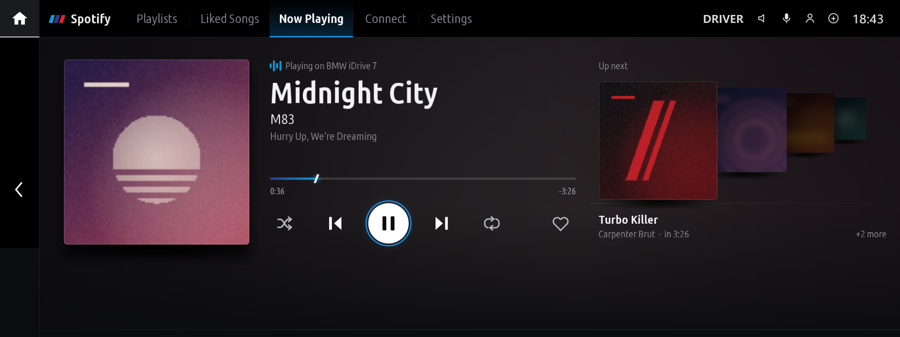
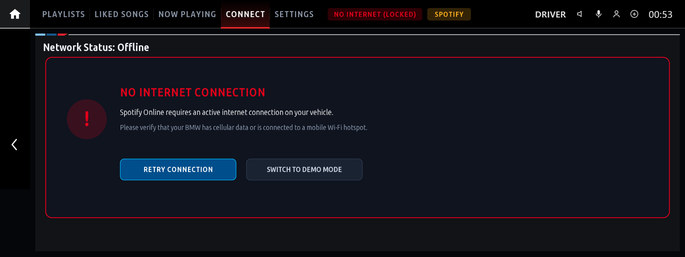
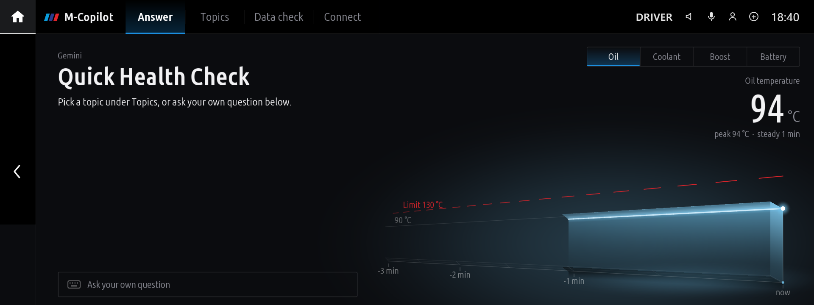
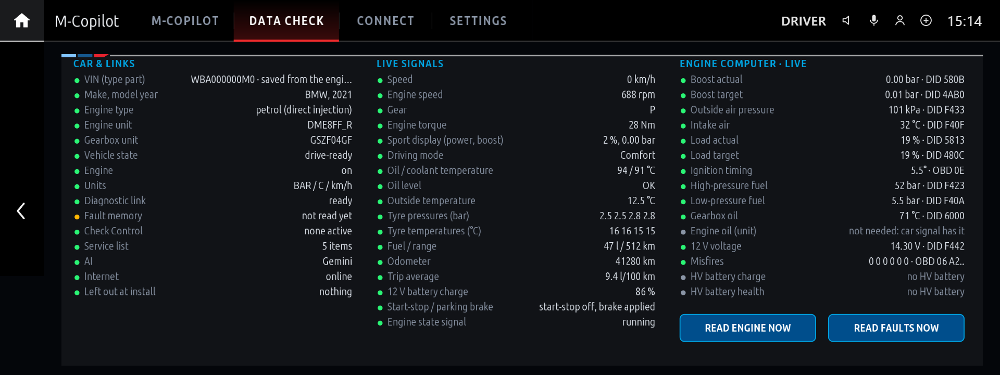
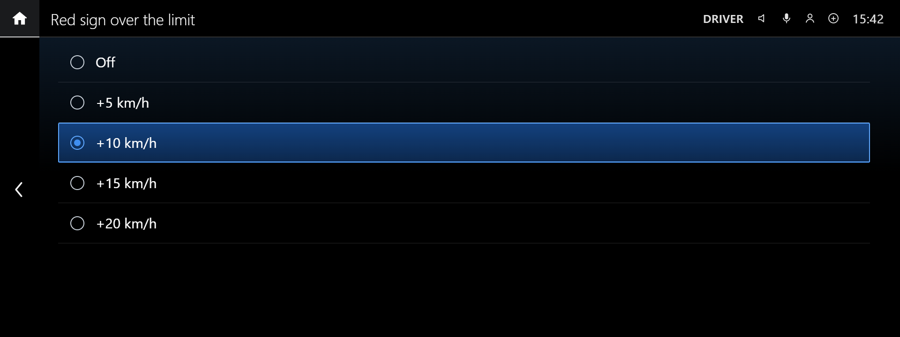
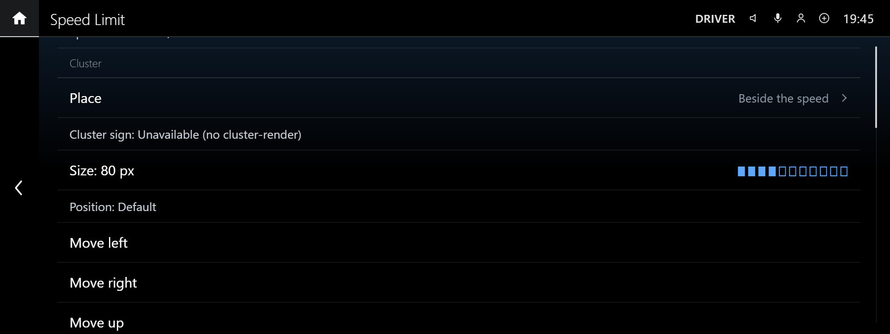
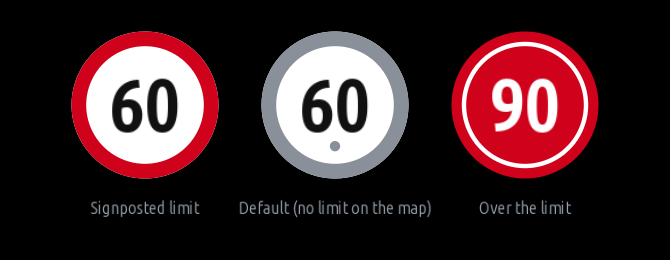
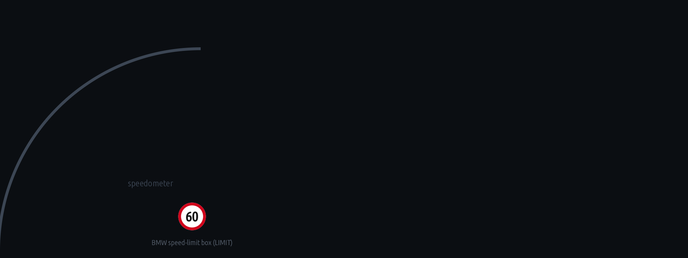

# iDrive 7 custom apps

Three apps for BMW iDrive 7 head units (MGU), installed through the [MGU Store](https://github.com/robertnisipeanu/mgu-store). They run on the app runtime and GPU renderer from [cauliflowermossgrape/idrive7-apps](https://github.com/cauliflowermossgrape/idrive7-apps).

| App | Version | Internet | Reads from the car |
| :--- | :---: | :---: | :--- |
| [Spotify](#spotify) | 1.0.32 | Yes | Nothing |
| [M-Copilot](#m-copilot) | 1.0.35 | Yes | Driving signals, service list, fault memory (read-only) |
| [Speed Limit](#speed-limit) | 1.0.7 | No | Position, speed and power state (read-only) |

System Monitor has moved to its own repository, [hexlay/idrive7-system-monitor](https://github.com/hexlay/idrive7-system-monitor). To keep getting updates, add `hexlay/idrive7-system-monitor` as a source in the MGU Store.

## Install

1. In the car, open **MGU Store > Sources > Add source** and enter `hexlay/idrive7-custom-apps`.
2. For Spotify and M-Copilot, add `cauliflowermossgrape/idrive7-apps` as a source too, and install the renderer (`idrive7-renderd`) and the controller gate (`mgu-inputgate`) from it. Most cars that run these apps already have them. Speed Limit needs neither.
3. Install the apps. New versions show up in the store.

Spotify and M-Copilot need the store's internet uplink: a phone hotspot, a USB-tethered phone, an LTE stick or a USB Ethernet adapter.

On older firmware (such as MainApp 6.5.5) the store leaves out any vehicle signal the head unit doesn't know, so the apps still install. The app's log lists what was left out.

## Spotify

Control Spotify Connect and browse your playlists and liked songs on the central display.

- Pair by scanning the QR code on the Connect tab and signing in to Spotify on your phone. Disconnect from the phone too.
- Now playing with seek, shuffle, repeat and like, Up Next, and switching between Spotify Connect devices. Playback control needs Spotify Premium.
- Demo mode plays sample music without an account.
- Settings: colour theme, screen size, layout and how often it syncs with Spotify.

| Now Playing | Liked Songs |
| :---: | :---: |
|  |  |
| **Pairing** | **No internet** |
|  |  |

## M-Copilot

An AI co-driver that answers with your car's own data: live readings, warning messages, the service list, the fault memory with BMW's fault descriptions, and a quick read of the engine computer (boost, intake air, timing, fuel pressure, misfires). Pick one of 24 topics or type your own question.

- Pair from your phone: scan the QR code on the Connect tab, choose Gemini, Claude, OpenAI, Groq or OpenRouter and enter your API key. You can also add a car profile (model, tune, mods) and the answer language there.
- While the car is moving, answers are short and in larger text, and typing is locked. Topics still work, and a half-typed question is kept for when you stop.
- The Data check tab shows which signals your car actually sends.
- Read-only. Fault memory and the engine computer are only read when a question needs them, never while the engine is starting or stopping.
- Nothing runs while the app is off screen.

| Your own question | Data check |
| :---: | :---: |
|  |  |
| **Connected** | **Phone page QR** |
|  |  |

The screenshots are from the browser emulator with its sample B58.

## Speed Limit

> [!WARNING]
> **Not tested in a car yet.** Everything was checked on a PC only: the road matching against replayed drives
> through Tbilisi, the head-up display and cluster output against a fake cluster-render, the page in the emulator.
> Never rely on it to drive; the signs on the road always win.

The speed limit of the road you're on, on the head-up display and on the cluster's map, worked out offline from an
OpenStreetMap map of Georgia that ships with the app. No internet, no BMW map, and nothing is sent to the car: it only
reads the car's position, speed and power state.

- **The page is laid out like Maps on cluster's**, as the car's own list (no GPU renderer):
  - **General:** **Show on** (Cluster, HUD, Cluster and HUD, or Off), **Red sign over the limit** (Off, +5,
    +10, +15 or +20 km/h), **When there's no limit** (Show nothing, or Show --- as BMW's own Speed Limit Info),
    **Speed cameras** (Warn or Off), and **Speed limit** (what it shows now).
  - **Cluster:** **Cluster sign**, **Size** (a slider), **Position** with **Move left / right / up / down** and
    **Default position** (the bottom of the phone map, left of the car's arrow). Greyed while Show on leaves the
    cluster out.
  - **HUD:** **HUD sign**, **Keep HUD sign over BMW's pop-ups**, **Size** (a slider), **Position** with **Move
    left / right / up / down** and **Default position**. They are greyed while Show on leaves the HUD out.
  - **Map:** the map data's date and licence.
- **Starts with the car** and runs in the background. Parked, locked or set to Off, it stops: it drops its
  subscriptions, closes the map and gives the head-up display and cluster back, so it draws no power.
- **Light:** the map is read from the file in small pieces (about 1 MB in memory instead of 15 MB), each update takes
  a few microseconds, and it wakes twice a second while driving, every 2 s while standing still, and never while
  parked or off (`kit/tools/test_speed_limit_power.js` counts it). It reads the speed once per update instead of
  taking the car's 10 a second, uses GPSData only while the navigation's position is missing, and asks cluster-render
  how the map is doing every 3 s only while its sign is on the map (else every 10 s). At start-up it waits for the
  car's power state, so a parked car's head unit starting up never opens the map or subscribes to anything.
- **Cluster:** on the phone map (Maps on cluster), at its bottom, left of the car's arrow, while that map is shown. Not beside the speed:
  that is the cluster slot BMW's own trip and board computer info uses, one at a time, so a sign there hides it.
- **Head-up display:** the round sign beside BMW's own speed; size and place on the page.
- **Speed cameras:** a camera ahead on your road, within 400 m and checking your direction, adds a pill to the sign
  with a camera and the distance (in 50 m steps, 10 m under 100 m), red when you're over the limit; it goes once
  you've passed it. From OpenStreetMap's speed cameras (about 260 in Georgia, 61 in Tbilisi; a third say which
  direction they check, the rest are warned both ways). Check that camera warnings are allowed where you drive.
- **Roads without a limit on the map** show the legal default with a grey ring: 60 km/h in a settlement, 90 outside,
  110 on motorways, 20 in living streets.
- It needs **cluster-render** for the head-up display and the cluster; it comes with Maps on cluster from the
  `robertnisipeanu/idrive-apps` source. Without it, the limit shows on the app's page only.

How it works: the car's navigation position (`Positioning.currentLocation`, or `GPSData`) is matched twice a
second to the nearest road within 25 m that runs the way the car is heading (one-way roads only the right way
round), and the limit for that direction is shown. Another road takes over after two updates in a row, or at once
at a junction. In a tunnel the last limit is kept until the position comes back.

| Show on | Red sign over the limit |
| :---: | :---: |
|  |  |
| **HUD settings** | **Show on: Cluster** (the HUD settings greyed) |
|  |  |
| **Cluster settings** | |
|  | |
| **Speed cameras** | |
|  | |
| **When there's no limit** | **The signs** |
|  |  |
| **Head-up display** (black is see-through) | **Cluster, over the phone map** |
|  |  |

The page screenshots are from the emulator with its demo drive on the Tbilisi Bypass Road. The head-up display and
cluster pictures are the layers the app sends to cluster-render, at their default places, drawn over a plain
background with the HUD's visible area outlined; they are not photos from a car. Map data © OpenStreetMap
contributors, [ODbL](https://opendatacommons.org/licenses/odbl/1-0/) (`apps/speed_limit/georgia.pack`, from
Geofabrik's Georgia extract).

## Phone pages

The pairing pages ([My cars](https://hexlay.github.io/idrive7-custom-apps/)) can be added to the home screen as an app called **iDrive Apps**: on iPhone use Safari's **Share > Add to Home Screen**, on Android Chrome's **Install app**.

New phone or cleared browser? Scan **Show QR for the phone page** on the app's Connect tab to get the car back.

## Privacy

- Keys and Spotify logins go from the phone to the car through the public relay `ntfy.sh`, end-to-end encrypted (AES-256-GCM) with a key that exists only in the car's QR code. Old or repeated messages are rejected. See [`kit/runtime/link_crypto.js`](kit/runtime/link_crypto.js).
- On the car they are stored in the app's data folder, readable only by that app. This repository contains no keys or secrets.
- Every request that carries a key checks the server's certificate.

## When an app says it's offline

If the store shows **Online** but an app doesn't, look at the `uplink:` line near the top of the app's log (`<app>.log` in its data folder):

- `lease <ip> via <interface>`: the app is routed, the problem is somewhere else.
- `no lease ... not routed`: reinstall the app from the store.
- `no lease ... uplink offline or not installed`: connect the store to a network first.

## Development

- `python3 kit/tools/build.py <app_id>` builds `dist/<app_id>@<version>.mgu`. It needs `oap-sdk`, extracted from your own head unit with `kit/tools/extract_sdk.js`.
- `node kit/tools/emu.js <app_id>` runs an app in the browser emulator. Add `--car b58` or `--car n63` for a sample car.
- The tests are in `kit/tools/test_*.js` and run in CI on Node 8.9.4 and 8.16.2, the versions on the head units.
- Speed Limit's map: `python3 kit/tools/pack_sli.py georgia-latest.osm.pbf -o apps/speed_limit/georgia.pack` (a
  Geofabrik extract; about a minute). `node kit/tools/test_speed_limit.js` replays drives through Tbilisi on it;
  after a build, `node kit/tools/test_speed_limit_power.js` checks its wake-ups from start-up to parked.

For the platform itself (signals, renderer, controller input, deploying over SSH) see [idrive7-apps](https://github.com/cauliflowermossgrape/idrive7-apps).

## Credits and license

Built on [cauliflowermossgrape/idrive7-apps](https://github.com/cauliflowermossgrape/idrive7-apps) (MIT): the runtime, renderer, vehicle signals and diagnostics transport. M-Copilot also uses its fault-text database (`dtc_db.pack`) and the engine and battery identifier tables from its M Vitals and eDrive apps. The [MGU Store](https://github.com/robertnisipeanu/mgu-store) is by Robert Nisipeanu.

Released under GPL-3.0-or-later ([`LICENSE`](LICENSE)). The MIT notice of idrive7-apps is kept in [`LICENSE.MIT`](LICENSE.MIT) and ships with every app package. `kit/renderd` keeps its own licence files.

Not affiliated with or endorsed by BMW AG.
