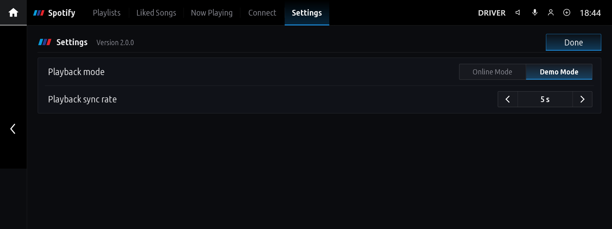
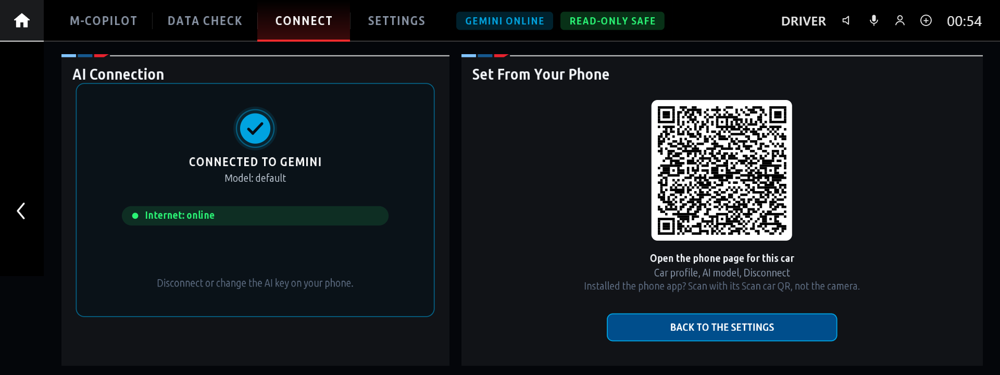
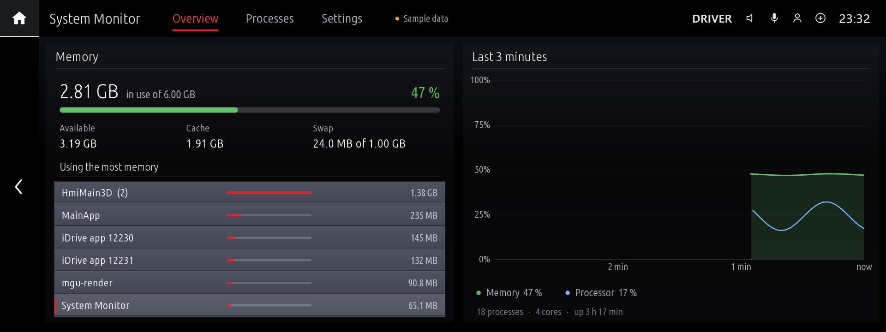
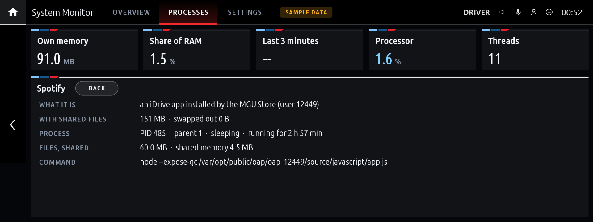

# BMW iDrive 7 (MGU) — Custom Apps Suite

<p align="center">
  <b>Custom applications for BMW iDrive 7 (MGU High / Intel Atom A3960), drawn on the head unit's GPU (its renderer composites at 60 fps) and installed through the MGU Store.</b>
</p>

<p align="center">
  
  
  
  
</p>

---

## Credits & Acknowledgements

This repository is built on the open-source BMW iDrive 7 platform:

* [**cauliflowermossgrape/idrive7-apps**](https://github.com/cauliflowermossgrape/idrive7-apps) — the app runtime, the native OpenGL ES renderer, SOME/IP vehicle signals and the TASU UDS diagnostic transport.
  M-Copilot uses that project's Fault Scanner fault-text database (`dtc_db.pack`) and the engine and battery identifier tables of its M Vitals and eDrive apps (MIT License, Copyright (c) 2026 cauliflowermossgrape).
* [**mgu-store**](https://github.com/robertnisipeanu/mgu-store) — the in-car app store, package manager and internet uplink by Robert Nisipeanu.

> [!NOTE]
> For SDK extraction, toolchain documentation, SOME/IP signal catalogs and renderer internals, see [**cauliflowermossgrape/idrive7-apps**](https://github.com/cauliflowermossgrape/idrive7-apps).

---

## Included Applications

| App | Version | Needs internet | Touches vehicle ECUs |
| :--- | :---: | :---: | :--- |
| [Spotify](#1-spotify-spotify) | 1.0.30 | Yes | No |
| [M-Copilot](#2-m-copilot-m_copilot) | 1.0.31 | Yes | No (reads driving signals, service list and fault memory) |
| [System Monitor](#3-system-monitor-sys_monitor) | 1.0.4 | No | No (reads the head unit's own memory and processes) |

> [!NOTE]
> **M-Cinema (YouTube player) has been removed**: playback was unreliable on some firmware and the sound was poor, and CarPlay and Android Auto workarounds play YouTube better.

### 1. Spotify (`spotify`)
**Spotify Connect controller and library browser on the iDrive 7 central display.**


* **Pair from your phone**: the Connect tab shows a QR code for [`pair.html`](https://hexlay.github.io/idrive7-custom-apps/pair.html). Sign in to Spotify on your phone (cellular data or Wi-Fi) and the login reaches the car end-to-end encrypted (see [Privacy & Security](#privacy--security)). Switching account is a disconnect and a new pairing, both from the phone.
* **Library & playback**: all your playlists and liked songs (more load as you scroll; the library shows at once when the app opens, from a copy kept on the car, and refreshes in the background), Liked Songs played as Spotify's own collection, now playing with tap-to-seek, shuffle, repeat and like, Up Next you can jump into, and switching between Spotify Connect devices. Buttons that wait for Spotify show a spinner until it answers. Georgian titles and artists are shown in Georgian script. When something fails (no device to play on, Premium needed, no connection) a short message says why; with no active device, playback starts on the phone that played last.
* **Internet through the MGU Store uplink**: looks up names through the uplink's DNS (see [Internet access](#internet-access)) and checks connectivity with a real HTTPS request. Without internet the player locks with **NO INTERNET CONNECTION**, **Retry** and **Switch to Demo Mode**.
* **Sized for your display**: rows, buttons and text are sized in millimetres on the glass, as CarPlay sizes its own, so they are as easy to read and press on a 10.25" display as on a 12.3" one (the 12.3" display shows more rows instead). A tap just beside a button still presses it, and no text is drawn too small to read. The display is found on its own.
* **Settings tab**: colour theme (M Tricolour by default, M Red, Ice White, Night Amber), playback mode (Online, or Demo with sample music and no account), screen size (Automatic, 10.25", 12.3", 8.8"), screen layout (full screen or standard), renderer (GPU, or software) and how often playback is synced with Spotify (1 to 10 s, every 2 s by default).
* **Light on the head unit**: up to 30 frames a second while music plays and 10 when paused, and a paused screen that doesn't change isn't drawn again (about once a second instead).
* **Foreground only**: nothing runs while Spotify is off screen. A disconnect sent from the phone meanwhile is applied when you come back to it, or at the next start within 12 hours. The pairing survives restarts.

| Now Playing | Liked Songs |
| :---: | :---: |
|  |  |
| **Phone QR Pairing & Devices** | **No Internet** |
|  |  |
| **Settings** | |
|  | |

---

### 2. M-Copilot (`m_copilot`)
**AI co-driver and assistant for BMW G-Series vehicles.**


* **Ask about your car**: 24 topics in four groups (**Check**, **Drive**, **Perform**, **Know-how**), from a health check and service due to launch, heat soak and known weak points, worded for a stock daily car as well as a tuned one. Or type your own question with the on-screen keyboard. Under each answer, one-tap follow-ups (*What should I do?*, *Safe to keep driving?*, *Explain more*) go on in the same conversation.
* **Knows which car it is in**: make and model year from the VIN (MainApp hands it to every app it starts), the engine type, and the engine and gearbox control unit types, which name the engine family and gearbox (read once per car and kept). The serial part of the VIN never leaves the car.
* **Your car profile (optional)**: on the phone page, add the model, tune stage, power, modifications, tyres, fuel and how you use the car. It is sent end-to-end encrypted like the key and can be changed at any time without re-pairing. A tuned car gets advice for its higher load.
* **Answers from your car's real data**: speed, rpm, gear, torque, boost, driving mode, engine state, auto start-stop, parking brake, oil and coolant temperature, oil level, outside temperature, tyre pressures and temperatures against the car's own targets, fuel, range, trip average, odometer, 12 V battery charge, the M xDrive setting on M models, and the cluster's own service list (oil, brakes, brake fluid, inspections, with distance and date). A value the car hasn't sent is named as unavailable: M-Copilot never fills in a number.
* **Remembers the drive**: while M-Copilot is on screen it keeps a few running figures of the drive: top speed and rpm, oil and coolant range, revving with cold oil, time at high rpm, peak g, the hottest tyre, and from light engine-computer samples under load, intake air heat, boost falling short of its target and the lowest ignition timing. "How was that drive?" and the tune and heat questions use them.
* **Short when moving, full when parked**: while the car is moving, answers are three short lines in larger text, to glance at; standing, up to eight lines.
* **Cancel a slow answer**: while M-Copilot is answering, a *Cancel* button sits under it (touch or the controller). It closes the request to the AI at once and stops what was still being read for it (fault memory, engine computer); the next question can be asked straight away.
* **Your units and language**: numbers come in the car's own units (psi or bar, °F or °C, miles or km, as set in the iDrive), and answers in the language picked on the phone page: English, Georgian, or German, French, Spanish, Italian, Dutch, Portuguese, Turkish or Polish (shown without accents; the car's fonts draw Latin and Georgian). Add the country you drive in, and answers follow its fuels, inspections, tyre rules and climate.
* **A look into the engine computer**: with each question, a quick read-only snapshot of what M Vitals shows live: boost actual vs target, intake air temperature, air charge (load) actual vs target, ignition timing, high- and low-pressure fuel, misfires per cylinder, gearbox oil temperature and 12 V voltage; on plug-in hybrids also the high-voltage battery's charge and health. It runs only while the car is steady, within a few seconds, and is kept for 20 s. Made for the engines of iDrive 7 cars: the B38 / B48 / B58 (one engine computer), the twin-turbo V8s (N63 / S63, an engine computer per cylinder bank: misfires of all eight cylinders, the 12 V from the gearbox unit when the engine units don't give it) and the B47 / B57 diesels (boost from the standard OBD request their units answer; no ignition timing). An identifier an engine doesn't answer is skipped for the next one.
* **Warning messages and fault memory**: the Check Control messages active in the cluster are always part of the context. The health check and faults topics (or any question about faults) also read the stored faults of every control unit, with BMW's own fault descriptions (the Fault Scanner's fault-text database), so the AI explains the actual faults instead of hex codes. Each fault says whether it is **active now**, happened during this drive or is an older stored one, and whether it asked for the warning lamp, so the answer leads with what matters now.
* **Pair from your phone**: M-Copilot opens on its Connect tab with a QR code. Scan it and enter the provider and API key on [`copilot.html`](https://hexlay.github.io/idrive7-custom-apps/copilot.html); the key reaches the car end-to-end encrypted, as with Spotify. Once paired, the tab shows the connection (provider, model, internet) and what the phone set (car profile, AI model), with a QR code to open the phone page.
* **Disconnect from the phone only** (the car's page or *My cars*): the car drops the AI key and what the phone set and shows a new QR code. A new AI key is also set from the phone. Spotify works the same way.
* **Settings tab**: colour theme: M Tricolour by default, M Red, Ice White or Night Amber.
* **Data check page**: a second tab shows what this car actually gives, in three columns, each row green with its value or grey / amber with why there is none (waiting for the car, not on this car's firmware, not on this engine, car asleep, error):
  * **Car and links**: the VIN (type part) and where it came from, make and model year, engine type, the engine unit(s) (both of a V8) and the gearbox unit, the vehicle state, the car's display units, the diagnostic link, the last fault read, Check Control, the service list, the AI and the internet.
  * **Live signals**, what the car sends by itself (no diagnostic request): speed, rpm, gear (P / R / N / D3), torque, the sport display's power and boost, driving mode (every mode name and number the car may send, the plug-in hybrids' too), oil and coolant temperature, oil level, outside temperature, tyre pressures and temperatures, fuel and range, odometer, trip average, 12 V charge, start-stop and parking brake. Fields a car may not send by itself (tyres, trip computer, service list) are read again every 10 to 60 s.
  * **Engine computer, live**: while the page is on screen it reads the engine unit continuously over the diagnostic link, as M Vitals and Live Data do (a round of values, a short rest, the next; misfires and the high-voltage battery every fourth round), each value with the identifier that answered it. Read-only, one request at a time, with the ignition on; never while the engine is starting or stopping, and it stops when you leave the page. A value the engine unit refuses rests 30 s before it is asked again. Boost, load, timing and misfires need the engine running.
  *Read faults now* reads every unit's fault memory on demand, *Read engine now* a full round at once, under the same safety rules. (The screenshot is the browser emulator with its sample car, `--car b58`: made-up values of a B58 idling in P.)
* **Safe with the engine on or off**: driving data are passive subscriptions. Diagnostic reads (fault memory, and the one-time identification) are read-only requests in the default session, made only when a question needs them, and never while the engine is starting or the car is switching off; M-Copilot waits for a steady state instead. What is read follows the car's state: parked without ignition (units asleep) a fault read is marked as possibly incomplete and the engine computer is left alone; with the engine off, boost, load, timing and misfires are not read, and voltages, oil level and temperatures are labelled for what they then mean.
* **Your choice of AI provider and model**: Google Gemini, Anthropic Claude (Claude Haiku 5.5 by default), OpenAI, Groq or OpenRouter, and the model on the phone page (e.g. Flash-Lite first, Claude Sonnet 5.5). The status bar shows the model that answered; when Gemini Flash is overloaded, Flash-Lite answers instead. Connections are reused, so an answer doesn't wait for a new TLS handshake.
* **Sized for your display**, as in Spotify: topics, keys, chips and answers.
* **Foreground only**: driving signals, warning lights, the service list, pairing checks and the internet check run only while M-Copilot is on screen; once you leave it nothing is subscribed, drawn or polled. What the phone sends meanwhile (a disconnect, a new key, profile or model) is picked up the next time the app is opened, within 12 hours: the relay keeps it that long, and the car is never woken for it. Until the car has a new key, the phone page says it is waiting for the car. The API key is stored once, in the app's data folder (readable by the app only).

| Ask Your Own Question | Data Check |
| :---: | :---: |
|  |  |
| **Phone QR Pairing** | **Connected** |
|  |  |

---

### 3. System Monitor (`sys_monitor`)
**What uses the head unit's memory and processor, as a computer's activity monitor shows it.**



* **Overview**: tiles across the top, as the idrive7-apps' own: memory in use of the head unit's total (amber when it gets full, red when nearly full), what the **iDrive apps** and the **other programs** take, what is still available (with the swap), and how busy the **processor** is (with its load; a tap opens the Processor page). Under them the apps and programs using the most memory, each with a bar and how much it grew, and a chart of the last three minutes of memory and processor use with the number of processes, the processor's cores and how long the head unit has been up.
* **Processor**: tiles of how busy it is, its load (processes running or waiting to, averaged over a minute and over 15), its temperature and clock (where the head unit lets an app read its sensors; else those tiles are left out) and its threads. Under them each core with a bar, and one bar of what the time went to: programs, the system (the kernel), and waiting on storage; and the apps and programs keeping it busy (a tap: its details).
* **Processes**: every app and program with its memory, its share of the RAM, **how much it grew in the last 3 minutes** (a memory leak shows as a steady rise, amber from +10 MB, red from +50 MB) and its processor use. Tap a heading (*Name*, *Memory*, *Last 3 min*, *Processor*) to sort by it; the list scrolls with a finger or the controller. With **Group processes by app** (the default) an app's or program's processes are added up into one row, with how many there are; off, each process has its own row with its PID.
* **The memory each one takes**: its own memory (its private resident memory: what it allocated), which is what it adds to the RAM in use. The program and library files a process has in memory are shared with every other process that uses them (every iDrive app maps the same `node`), so counting them per process would add up to far more than is in use; they are under *System and shared*, and in a row's details.
* **Which app is which**: each iDrive app runs as its own user id, so its processes are told apart by that instead of all being `node`. Apps installed by the **MGU Store** are named from its records (`/var/opt/mgu-deploy/state.json`, which any app may read), and marked *MGU Store*; so are the Store's own programs (its updater). MainApp and the System Monitor are named too. **BMW's own apps** show as *iDrive app 12204* (their uid): MainApp keeps which uid is which app in its own folder, and the installer makes each app's folder readable to that app and MainApp only. A program's full name is shown even where Linux cuts it to 15 characters, and a bare `node` or `python` that is no app is named after the script it runs (*foreground_gate (node)*), or the MGU Store tool it belongs to.
* **Details**: tap a row for tiles of its own memory, share of RAM, growth, processor use, threads or processes; what it is (an MGU Store app, BMW's, a program); its size with the files it shares, and what is swapped out. For one process also its PID, parent, state, how long it has run and its command line; for a group, each of its processes.
* **A viewer only**: it reads Linux `/proc` and the Store's records, and nothing else. It cannot end, pause, signal or start anything: its code has no call that would (the build fails if one is ever added: `test_sys_monitor.js` checks the code and the manifest), it asks for no car signals and no internet, and it runs as its own unprivileged user, whom Linux doesn't let signal another app's process anyway. Processes the head unit doesn't let an app read are counted, *n not readable*, not guessed. Should a head unit mount `/proc` so that apps see only their own processes (`hidepid`), the app says so instead of showing an almost empty list; the memory figures are the whole head unit's either way.
* **Checked on Linux as on the car**: the built package, installed with the installer's owners and modes (`oap_<uid>`, 750) next to the Store's records (0644), run as an app's uid on the head unit's Node 8.9.4 and 8.16.2. Memory in use equal to `free`'s; each process's own memory equal to the kernel's page-table count (`smaps_rollup`) and its resident size to `ps`; a busy loop read as exactly one core, on one core of the per-core bars; the load equal to `/proc/loadavg`; a bare `node` named after its script; an app leaking 3 MB a second shown growing 90 MB in 30 s; MGU Store apps and tools named, BMW-style apps by uid; the kernel refusing it to signal any other app's process; `/proc` with `hidepid=2` / `invisible`; and 1,500 samples of 430 processes coming and going (about 16 ms each on a desktop processor, no memory growth).
* **Foreground only, light on the head unit**: it reads `/proc` only while it is on screen, every 2 s by default (*Update every*: 1, 2, 5 or 10 s), and draws a frame only when something changed. The history starts when the app opens.
* **Settings tab**: colour theme (M Tricolour by default, M Red, Ice White, Night Amber), grouping and the update rate.
* On a computer without `/proc` (the browser emulator on Windows) it shows sample data; the screenshots here are of it.

| Processor | Processes |
| :---: | :---: |
|  |  |
| **Details** | |
|  | |

---

## How to Install via MGU Store

The recommended way to install and update these apps is the [**MGU Store**](https://github.com/robertnisipeanu/mgu-store):

1. On the central display, open **MGU Store > Sources > Add source**.
2. Enter this repository:
   ```text
   hexlay/idrive7-custom-apps
   ```
3. Tap **OK**. The MGU Store reads `mgu-repo.json` and lists the three apps. They need the GPU renderer (`idrive7-renderd`) and the controller gate (`mgu-inputgate`), which the store doesn't install from this repository: add [cauliflowermossgrape/idrive7-apps](https://github.com/cauliflowermossgrape/idrive7-apps) as a source too and install them from there (most cars with these apps have them already). `kit/renderd` here is a copy of their source, used by the browser emulator and the SSH deploy kit.
4. Tap an app to install it. Updates appear in the store when a new version is pushed.

### Older firmware (e.g. MainApp 6.5.5)

The head unit's installer refuses an app outright if its SOME/IP manifest names an interface, field or method the firmware's catalog (`/etc/oap/someip/someip-interfaces.json`) doesn't have, and older firmware has fewer. The MGU Store builds these apps on the head unit, and the build fits each app's vehicle signals to that unit's catalog: what the unit lacks is left out, so the app installs and runs without those values. The app's log lists them at start (`this unit has no ... - running without it`).

2019 head units run Node 8.9.4 (later ones 8.16.2). Everything that runs in the car is checked on both: the tests run on them in CI (`.github/workflows/tests.yml`), and the apps' own code uses nothing newer. The apps need no internet to build, so the Store builds them even while the uplink is offline.

### The phone app

The phone pages ([My cars](https://hexlay.github.io/idrive7-custom-apps/), M-Copilot's and Spotify's) install as an app, **iDrive Apps**, for all your cars one tap from the Home Screen:
* **iPhone**: in Safari, tap **Share**, then **Add to Home Screen**. Open **iDrive Apps** from the Home Screen and add your cars with its **Scan car QR**: on iPhone the Home Screen app keeps its own cars, apart from Safari's (a car QR code scanned with the camera opens in Safari).
* **Android**: in Chrome, tap **Install app** on My cars (or the **⋮** menu, then **Install app** / **Add to Home screen**). The app shares Chrome's cars.

A phone that no longer has a car (a new phone, a cleared browser, another browser) gets it back by scanning *Show QR for the phone page* on the app's Connect tab, and can then disconnect it. The page shows the car's own settings (provider, model, car profile, never the key).

### Internet access

Spotify and M-Copilot need the MGU Store's **internet uplink** (`mgu-uplink`): Wi-Fi such as a phone hotspot, a USB-tethered phone, an LTE stick or a USB Ethernet adapter. The store routes only apps that declare `"mguInternet": true`, and the head unit's own resolver cannot reach the internet, so these apps resolve names through the DNS servers of the uplink's lease (`kit/runtime/uplink.js`).

The phone link uses the public relay `ntfy.sh`, which limits requests per internet address. The apps read their pairing channel through one long-lived connection (`kit/runtime/relay_stream.js`) instead of polling it, so a car, an emulator and the phone sharing one connection don't use up the limit; the phone pages send with plain requests (no CORS preflight) and try again when the relay is briefly unreachable.

If an app says it is offline while the store shows **Online**, look for the `uplink:` line at the start of the app's log (`<app>.log` in its data folder):
* `lease <ip> via <interface>` — the app is routed; the problem is elsewhere.
* `no lease ... uplink is online but this app is not routed` — reinstall the app from the store so it is added to the uplink's app list.
* `no lease ... uplink offline or not installed` — connect the store to a network first.

---

## Platform & Developer Documentation

For everything else, including:
* **SDK extraction & setup** (`kit/tools/extract_sdk.js`)
* **Vehicle SOME/IP signal catalogs**
* **The native C / Wayland / OpenGL ES GPU renderer** (`mgu-render`)
* **Controller input hooks** (`mgu-inputgate`)
* **OBD-ENET / SSH deployment scripts**
* **Creating new apps**

👉 **See the source repository: [cauliflowermossgrape/idrive7-apps](https://github.com/cauliflowermossgrape/idrive7-apps)** and the [**MGU Store guide**](https://github.com/robertnisipeanu/mgu-store).

To build locally: `python3 kit/tools/build.py <app_id>` writes `dist/<app_id>@<version>.mgu` and `.tgz` (it needs `oap-sdk`, extracted from your own head unit with `kit/tools/extract_sdk.js`). `node kit/tools/emu.js <app_id>` runs an app in the browser emulator (an app's native screens and the head unit's settings screen included, drawn as the HMI draws them; `--car b58` or `--car n63` adds a sample car whose signals and control units answer, `kit/tools/emu-car.js`), and `node kit/tools/preview.js dist/<app_id> <outDir>` renders it to PNGs.

---

## Privacy & Security

* **No hardcoded secrets**: this repository contains no API keys, client secrets, tokens or personal identifiers.
* **End-to-end encrypted pairing**: Spotify tokens and AI provider keys travel from the phone to the car through a public relay (`ntfy.sh`), encrypted with AES-256-GCM using a key that only exists in the car's QR code (in the link's `#k=` fragment, which browsers never send to a server). The car accepts only messages that decrypt and authenticate with that key. What the car tells the phone (paired, its settings) is encrypted too, with a second key derived from it (HKDF-SHA256), so neither side can be fooled by its own messages. Every message carries its send time and a nonce inside the encryption: a message re-posted to the channel later, or a repeat, is dropped ([`kit/runtime/link_crypto.js`](kit/runtime/link_crypto.js)).
* **Keys on the phone**: the pages read the key from the QR link, remove it from the address bar at once, and keep it as a **non-extractable** WebCrypto key in the browser's IndexedDB: the pages can use it, but no script can read the key back out. [`docs/index.html`](https://hexlay.github.io/idrive7-custom-apps/) lists the cars a phone has (**My cars**) and scans QR codes in the page; only this site's own pairing links are accepted. The 8-character code shown on the car only finds a car the phone already has, so a code seen on the screen is no use to anyone else.
* **Hardened pages**: a Content Security Policy limits where the pages may connect (`ntfy.sh`, and Spotify's token endpoint on the Spotify page) and load code from (this site only; the QR decoder is vendored in [`docs/vendor`](docs/vendor), not loaded from a CDN), no referrer is sent, and the pages refuse to run inside another site's frame. The Spotify login uses PKCE with a random verifier and a random `state` checked on return, so a login the page didn't start is never sent to a car.
* **Verified TLS**: all requests that carry tokens or keys verify the server's certificate chain and hostname; only the head unit's possibly wrong clock is tolerated.
* **Local data**: tokens (`spotify_auth.json`, `copilot_auth.json`) and app state stay in each app's data folder on the head unit, one copy each (readable by the app only); a copy an older version kept next to the app's code is moved there.
* **Git protection**: auth, state and key files (`*_auth.json`, `*_state.json`, `*.key`, `*.pem`) are excluded in `.gitignore`, and the build never packages them.
* **Tested**: `node kit/tools/test_carlink.js` runs the page library against the car modules (tampering, replays, foreign links, the relay's limits); `node kit/tools/test_spotify.js` runs Spotify's client against a fake Web API, `test_spotify_auth.js` checks where it keeps the login, `test_copilot_signals.js` feeds M-Copilot's signal decoding what cars send (names, wire numbers, plug-in hybrid driving modes, psi tyres, "no value"), `test_copilot_engines.js` runs its engine reads against stand-in engine units (B48, B58, V8s with one or two engine computers, a B57 diesel), `test_copilot_cancel.js` cancels a question to an AI that never answers, `test_sys_monitor.js` runs the System Monitor's `/proc` reading against a made-up `/proc` and app folder, and `kit/tools/test_zh.js` / `test_zh.py` check the language builds. All but `test_carlink.js` (the phone pages' WebCrypto) also run on the head unit's Node 8.9.4 and 8.16.2, in CI on every push.

---

## License

This project is released under the GNU General Public License v3.0 or later ([`LICENSE`](LICENSE)).
It is built on [cauliflowermossgrape/idrive7-apps](https://github.com/cauliflowermossgrape/idrive7-apps), released under the MIT License: its copyright and permission notice are kept in [`LICENSE.MIT`](LICENSE.MIT), and every app package carries both files. The renderer source in `kit/renderd` keeps its own licence files.
Not affiliated with or endorsed by Bayerische Motoren Werke (BMW) AG.
