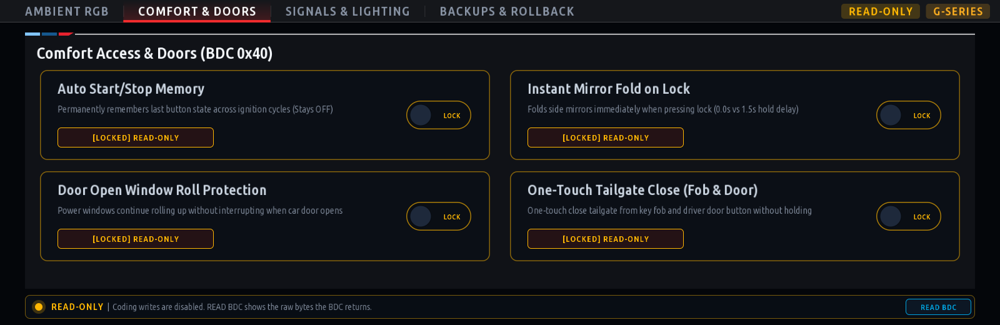
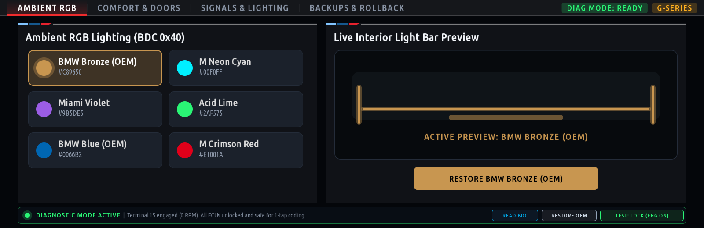
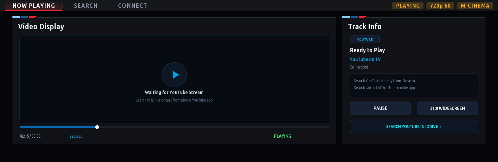
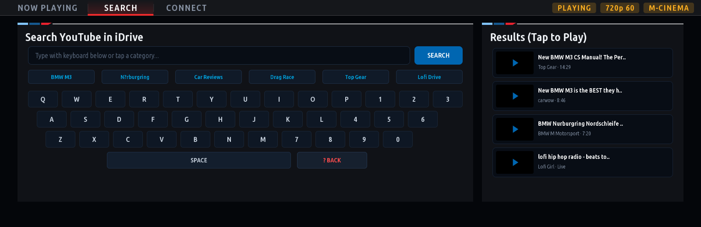
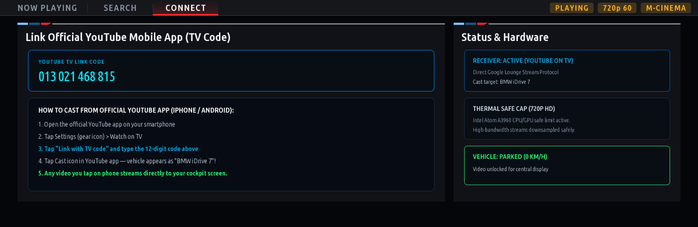

# BMW iDrive 7 (MGU) — Custom Apps Suite

<p align="center">
  <b>A curated collection of custom applications for BMW iDrive 7 (MGU High / Intel Atom A3960), rendered at 60 fps directly on the vehicle's GPU.</b>
</p>

<p align="center">
  
  
  
  
</p>

---

## Credits & Acknowledgements

This repository is forked and built upon the foundational open-source BMW iDrive 7 platform:

* [**cauliflowermossgrape/idrive7-apps**](https://github.com/cauliflowermossgrape/idrive7-apps) — The foundational runtime, native OpenGL ES GPU rendering daemon, SOME/IP vehicle telemetry bridges, and TASU UDS diagnostic engine for BMW iDrive 7.
* [**mgu-store**](https://github.com/robertnisipeanu/mgu-store) — The in-car app store and package manager for BMW iDrive 7 by Robert Nisipeanu.

> [!NOTE]
> For core SDK extraction, toolchain documentation, low-level SOME/IP signal catalogs, and C/OpenGL renderer internals, please refer directly to the source repository at [**cauliflowermossgrape/idrive7-apps**](https://github.com/cauliflowermossgrape/idrive7-apps).

---

## Included Applications

### 1. QuickCode (`quick_code`)
**One-tap cockpit coding with automated backups for all BMW G-Series vehicles.**





* **Strict Low-Risk BDC Architecture (`0x40`)**:
  - Restricts all coding writes exclusively to the **Body Domain Controller (BDC_BODY3, `0x40`)**.
  - High-risk modules (**HU_MGU `0x63`**, **DME `0x12`**, **DSC `0x29`**) are completely excluded from coding writes, physically eliminating any risk of head unit black-screen, crash, or bootloop failures.
* **Safe Comfort & Lighting Options**:
  - **Auto Start/Stop Memory (`TC_MSA_MEMORY`)**: Permanently remembers the last button state across ignition cycles (stays OFF).
  - **Instant Mirror Fold on Lock (`KOMFORT_SCHLIESSEN`)**: Folds side mirrors immediately (`0.0s` delay vs factory `1.5s` hold delay).
  - **Continuous Window Roll-Up (`FH_TUERAUF_STOP_MAUT`)**: Windows continue rolling up uninterrupted when a door opens.
  - **One-Touch Tailgate Close (`HK_TASTE_TIPP_SCHLIESSEN`)**: One-touch close tailgate from key fob and driver door button without holding.
  - **5-Flash Comfort Turn Signals (`PIA_DEFAULT_TIPPBLINKEN`)**: One-touch indicator flashes 5 times instead of factory 3 flashes.
  - **Curb Monitor Mirror Tilt 70% (`ASP_BORDSTEIN_AUTOMATIK`)**: Passenger mirror dips 70% in reverse to show the curb and rim instead of pointing straight at the ground.
  - **Acoustic Lock/Unlock Chirp (`DEF_GLOBAL_LOCK_CLO`)**: Audible horn chirp confirmation on lock/unlock.
  - **Emergency Flashing Brake Lights (`BFD_ON`)**: Brake Force Display pulses outer brake lamps under heavy deceleration.
  - **Ambient RGB Color Palettes**: Presets for BMW Bronze (OEM), M Neon Cyan, Miami Violet, Acid Lime, BMW Blue (OEM), and M Crimson Red with live interior light tube preview.
* **Automated Pre-Coding Backups & 1-Tap Rollback**:
  - Automatically captures a timestamped snapshot of all parameters before every modification.
  - Dedicated **"Backups & Rollback"** tab with 1-tap `[RESTORE]` rollback and `[RESTORE ALL FACTORY OEM DEFAULTS]`.
* **Vehicle Safety Interlocks**:
  - Strictly locks coding if engine is running (RPM > 0) or vehicle is in motion (Speed > 0 km/h).
  - Enforces Terminal 15 Diagnostic Mode (3-press Start/Stop, engine off) matching BimmerCode and ISTA safety protocols.

---

### 2. Spotify (`spotify`)
**Native Spotify Connect controller and library browser directly on the iDrive 7 central display.**


* **Online Mode by Default**:
  - Automatically launches in **Online Mode** (`demo: "off"`) for live personal library browsing and playback control.
  - Requires authenticated personal account before showing demo tracks; launches directly to the **Connect** tab on fresh installations.
* **Real Cloud QR Code Pairing (Zero 127.0.0.1 / Works over 4G/5G)**:
  - Generates a unique pairing session and displays a crisp QR code pointing to `https://hexlay.github.io/idrive7-custom-apps/pair.html`.
  - Works on **any smartphone over cellular data (4G/5G) or car Wi-Fi** — completely eliminating failed `127.0.0.1` / localhost URLs.
  - Tap **"Connect with Spotify"** or paste your access token; tokens sync directly to the car via a secure ephemeral channel.
  - **Zero terminal, zero SSH, and zero Node commands required.**
* **Active Internet Connectivity Safeguard**:
  - Actively monitors connectivity to `api.spotify.com:443`.
  - If the vehicle loses internet, the player safely locks with a high-contrast **"NO INTERNET CONNECTION"** screen with `[RETRY CONNECTION]` and `[SWITCH TO DEMO MODE]` options.
* **Cockpit UI & Features**:
  - 60 fps animated mini equalizers on active tracks.
  - Browse personal playlists, saved library, and playback queue.
  - Instant target device switching across Spotify Connect speakers, phones, and vehicle audio.
  - Persistent token storage across ignition cycles.

| Phone QR Pairing Screen | Offline Connectivity Lock |
| :---: | :---: |
|  |  |

---

### 3. M-Cinema (`m_cinema`)
**Ultrawide 21:9 Cockpit Theater & Seamless YouTube Video Cast for BMW iDrive 7.**

| YouTube Cockpit Player (21:9) | In-Car YouTube Search & Speller | Official YouTube TV Code Link |
| :---: | :---: | :---: |
|  |  |  |

* **Direct YouTube Search in iDrive 7**:
  - Search any video directly from the central display using touch or the iDrive rotary controller.
  - Interactive on-screen BMW speller keyboard, 1-touch category chips (`BMW M3`, `Nürburgring`, `Car Reviews`, `Drag Race`), and live video results with instant playback.
* **Official YouTube App Casting ("Link with TV Code")**:
  - Connects with the official YouTube mobile app on iPhone and Android via Google's official **Lounge on TV** protocol.
  - In YouTube mobile app: **Settings > Watch on TV > Link with TV code** — enter the 12-digit code displayed on your cockpit screen. The vehicle permanently appears as a Cast target (`BMW iDrive 7`) in the official YouTube app!
  - Any video tapped on iPhone or Android routes directly to the iDrive cockpit display.
* **Decoded Video Thumbnail Artwork & 21:9 Ultrawide**:
  - Downloads and decodes official high-resolution YouTube video thumbnail art into the cockpit screen with ambient edge accents and rotary scrubbing.
* **Intel Atom A3960 Hardware Thermal Safe Cap**:
  - Capped to thermal-safe **720p 60** (cool & efficient) or **1080p 60** max limit, rejecting 4K/2K streams to protect the head unit processor from overheating.

---

### 4. M-Copilot (`m_copilot`)
**Performance telemetry, track metrics, and telemetry logging for BMW M & G-Series vehicles.**


* Real-time readouts of engine RPM, vehicle speed, coolant and oil temperatures, g-force vectors, and live tire pressures.
* High-contrast M-Performance cockpit aesthetics with dark-theme styling.

---

## How to Install via MGU Store

The recommended way to install and update these applications is through [**MGU Store**](https://github.com/robertnisipeanu/mgu-store):

1. On your iDrive central display, open **MGU Store > Sources > Add source**.
2. Enter this repository directly:
   ```text
   hexlay/idrive7-custom-apps
   ```
3. Tap **OK**. MGU Store fetches `mgu-repo.json` and immediately displays all apps.
4. Tap any app to install!

---

## Platform & Developer Documentation

For everything else, including:
* **SDK Extraction & Setup** (`kit/tools/extract_sdk.js`)
* **Vehicle SOME/IP Signal Catalogs**
* **Native C / Wayland / OpenGL ES GPU Renderer** (`mgu-render`)
* **Controller Input Hooks** (`mgu-inputgate`)
* **OBD-ENET / SSH Deployment Scripts**
* **Creating New Applications**

👉 **Please visit the source repository: [cauliflowermossgrape/idrive7-apps](https://github.com/cauliflowermossgrape/idrive7-apps)** and the [**MGU Store Guide**](https://github.com/robertnisipeanu/mgu-store).

---

## Privacy & Security

* **Zero Hardcoded Secrets**: This repository contains no private API keys, client secrets, tokens, or personal identifiers.
* **Local Data Isolation**: Authentication tokens (`spotify_auth.json`), coding states (`quick_code_state.json`), and pre-coding snapshots (`quick_code_backups.json`) are stored strictly on the local vehicle head unit partition (`dataDir`).
* **Git Protection**: Sensitive file extensions (`*_auth.json`, `*_state.json`, `*_backups.json`, `*.key`, `*.pem`) are strictly excluded in `.gitignore`.

---

## License

This project is released under the GNU General Public License v3.0 or later.  
Not affiliated with or endorsed by Bayerische Motoren Werke (BMW) AG.
