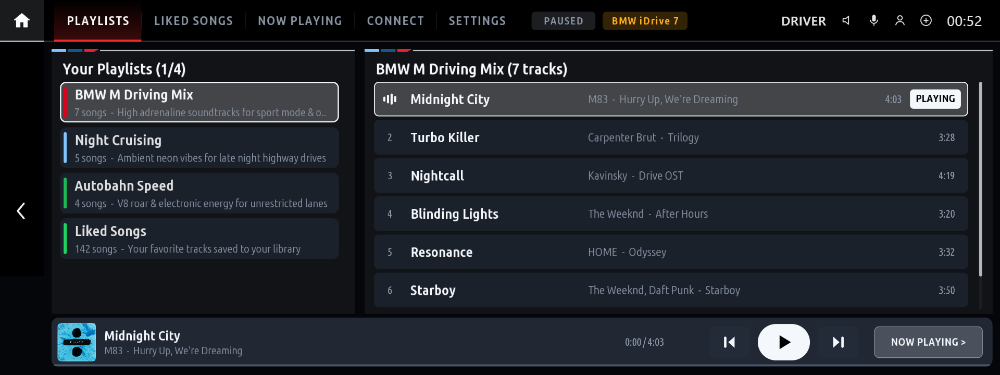
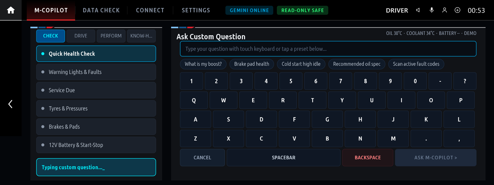
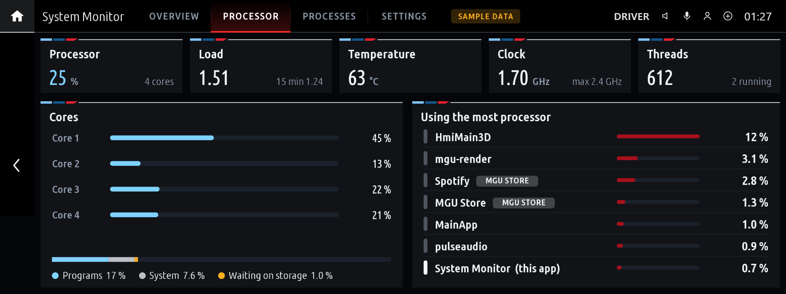
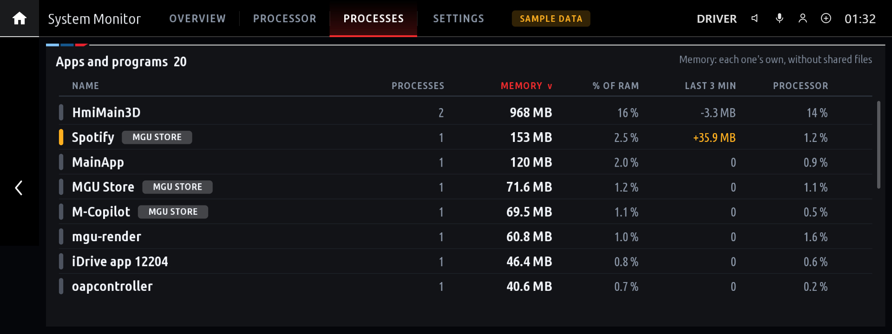

# iDrive 7 custom apps

Three apps for BMW iDrive 7 head units (MGU), installed through the [MGU Store](https://github.com/robertnisipeanu/mgu-store). They run on the app runtime and GPU renderer from [cauliflowermossgrape/idrive7-apps](https://github.com/cauliflowermossgrape/idrive7-apps).

| App | Version | Internet | Reads from the car |
| :--- | :---: | :---: | :--- |
| [Spotify](#spotify) | 1.0.30 | Yes | Nothing |
| [M-Copilot](#m-copilot) | 1.0.33 | Yes | Driving signals, service list, fault memory (read-only) |
| [System Monitor](#system-monitor) | 1.0.5 | No | Nothing, only the head unit's own processes |

## Install

1. In the car, open **MGU Store > Sources > Add source** and enter `hexlay/idrive7-custom-apps`.
2. Add `cauliflowermossgrape/idrive7-apps` as a source too, and install the renderer (`idrive7-renderd`) and the controller gate (`mgu-inputgate`) from it. Most cars that run these apps already have them.
3. Install the apps. New versions show up in the store.

Spotify and M-Copilot need the store's internet uplink: a phone hotspot, a USB-tethered phone, an LTE stick or a USB Ethernet adapter.

On older firmware (such as MainApp 6.5.5) the store leaves out any vehicle signal the head unit doesn't know, so the apps still install. The app's log lists what was left out.

## Spotify

Control Spotify Connect and browse your playlists and liked songs on the central display.

- Pair by scanning the QR code on the Connect tab and signing in to Spotify on your phone. Disconnect from the phone too.
- Now playing with seek, shuffle, repeat and like, Up Next, and switching between Spotify Connect devices. Playback control needs Spotify Premium.
- Demo mode plays sample music without an account.
- Settings: colour theme, screen size, layout and how often it syncs with Spotify.

| Now Playing | Liked Songs |
| :---: | :---: |
|  |  |
| **Pairing** | **No internet** |
|  |  |

## M-Copilot

An AI co-driver that answers with your car's own data: live readings, warning messages, the service list, the fault memory with BMW's fault descriptions, and a quick read of the engine computer (boost, intake air, timing, fuel pressure, misfires). Pick one of 24 topics or type your own question.

- Pair from your phone: scan the QR code on the Connect tab, choose Gemini, Claude, OpenAI, Groq or OpenRouter and enter your API key. You can also add a car profile (model, tune, mods) and the answer language there.
- While the car is moving, answers are short and in larger text, and typing is locked. Topics still work, and a half-typed question is kept for when you stop.
- The Data check tab shows which signals your car actually sends.
- Read-only. Fault memory and the engine computer are only read when a question needs them, never while the engine is starting or stopping.
- Nothing runs while the app is off screen.

| Your own question | Data check |
| :---: | :---: |
|  |  |
| **Connected** | **Phone page QR** |
|  |  |

The screenshots are from the browser emulator with its sample B58.

## System Monitor

Shows what uses the head unit's memory and processor, like a computer's activity monitor.

- Overview, per-core processor use and temperature, and every app and program with its memory and how much it grew in the last 3 minutes, which makes leaks easy to spot. Tap a row for details.
- Apps from the MGU Store are shown by name, BMW's own apps by their user id.
- It only reads `/proc`. It can't stop or change anything, and needs no car signals or internet.

| Processor | Processes |
| :---: | :---: |
|  |  |

The screenshots show the sample data it uses in the emulator.

## Phone pages

The pairing pages ([My cars](https://hexlay.github.io/idrive7-custom-apps/)) can be added to the home screen as an app called **iDrive Apps**: on iPhone use Safari's **Share > Add to Home Screen**, on Android Chrome's **Install app**.

New phone or cleared browser? Scan **Show QR for the phone page** on the app's Connect tab to get the car back.

## Privacy

- Keys and Spotify logins go from the phone to the car through the public relay `ntfy.sh`, end-to-end encrypted (AES-256-GCM) with a key that exists only in the car's QR code. Old or repeated messages are rejected. See [`kit/runtime/link_crypto.js`](kit/runtime/link_crypto.js).
- On the car they are stored in the app's data folder, readable only by that app. This repository contains no keys or secrets.
- Every request that carries a key checks the server's certificate.

## When an app says it's offline

If the store shows **Online** but an app doesn't, look at the `uplink:` line near the top of the app's log (`<app>.log` in its data folder):

- `lease <ip> via <interface>`: the app is routed, the problem is somewhere else.
- `no lease ... not routed`: reinstall the app from the store.
- `no lease ... uplink offline or not installed`: connect the store to a network first.

## Development

- `python3 kit/tools/build.py <app_id>` builds `dist/<app_id>@<version>.mgu`. It needs `oap-sdk`, extracted from your own head unit with `kit/tools/extract_sdk.js`.
- `node kit/tools/emu.js <app_id>` runs an app in the browser emulator. Add `--car b58` or `--car n63` for a sample car.
- The tests are in `kit/tools/test_*.js` and run in CI on Node 8.9.4 and 8.16.2, the versions on the head units.

For the platform itself (signals, renderer, controller input, deploying over SSH) see [idrive7-apps](https://github.com/cauliflowermossgrape/idrive7-apps).

## Credits and license

Built on [cauliflowermossgrape/idrive7-apps](https://github.com/cauliflowermossgrape/idrive7-apps) (MIT): the runtime, renderer, vehicle signals and diagnostics transport. M-Copilot also uses its fault-text database (`dtc_db.pack`) and the engine and battery identifier tables from its M Vitals and eDrive apps. The [MGU Store](https://github.com/robertnisipeanu/mgu-store) is by Robert Nisipeanu.

Released under GPL-3.0-or-later ([`LICENSE`](LICENSE)). The MIT notice of idrive7-apps is kept in [`LICENSE.MIT`](LICENSE.MIT) and ships with every app package. `kit/renderd` keeps its own licence files.

Not affiliated with or endorsed by BMW AG.
