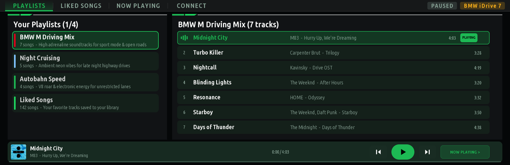
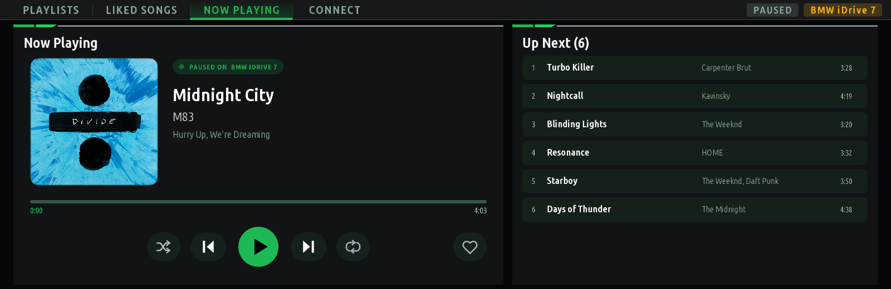
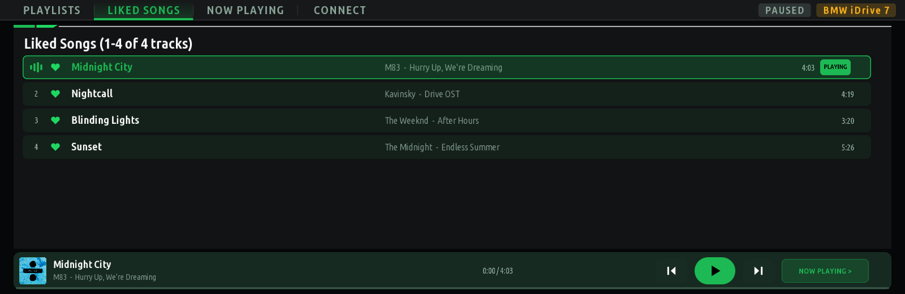
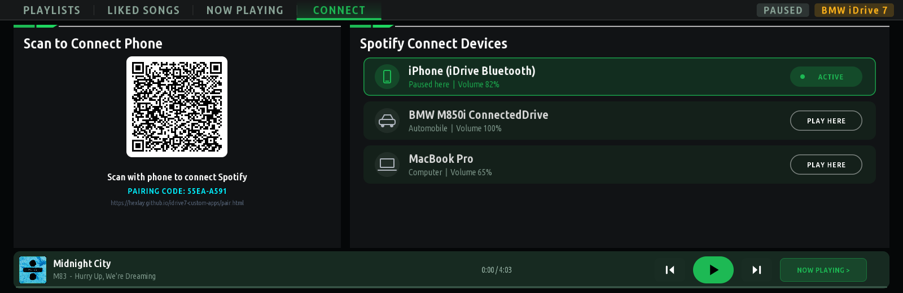
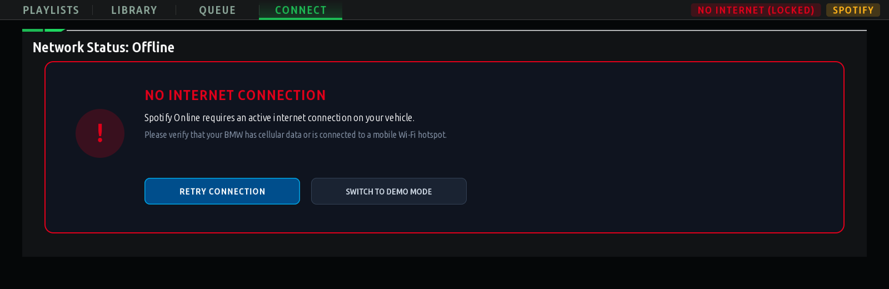
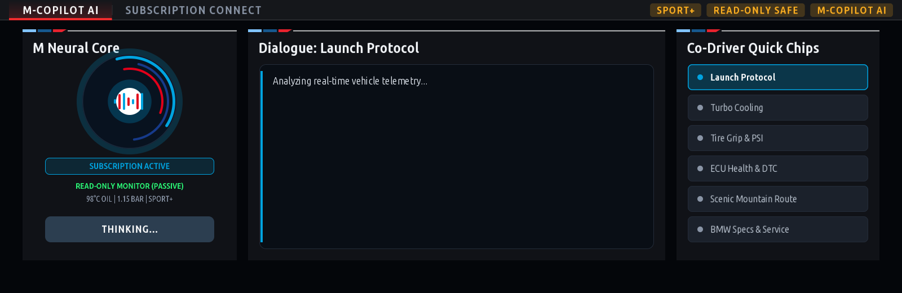

# BMW iDrive 7 (MGU) — Custom Apps Suite

<p align="center">
  <b>Custom applications for BMW iDrive 7 (MGU High / Intel Atom A3960), rendered at 60 fps on the head unit's GPU and installed through the MGU Store.</b>
</p>

<p align="center">
  
  
  
  
</p>

---

## Credits & Acknowledgements

This repository is built on the open-source BMW iDrive 7 platform:

* [**cauliflowermossgrape/idrive7-apps**](https://github.com/cauliflowermossgrape/idrive7-apps) — the app runtime, the native OpenGL ES renderer, SOME/IP vehicle signals and the TASU UDS diagnostic transport.
  M-Copilot uses that project's Fault Scanner fault-text database (`dtc_db.pack`) and the engine and battery identifier tables of its M Vitals and eDrive apps (MIT License, Copyright (c) 2026 cauliflowermossgrape).
* [**mgu-store**](https://github.com/robertnisipeanu/mgu-store) — the in-car app store, package manager and internet uplink by Robert Nisipeanu.

> [!NOTE]
> For SDK extraction, toolchain documentation, SOME/IP signal catalogs and renderer internals, see [**cauliflowermossgrape/idrive7-apps**](https://github.com/cauliflowermossgrape/idrive7-apps).

---

## Included Applications

| App | Version | Needs internet | Touches vehicle ECUs |
| :--- | :---: | :---: | :--- |
| [Spotify](#1-spotify-spotify) | 1.0.15 | Yes | No |
| [M-Copilot](#2-m-copilot-m_copilot) | 1.0.7 | Yes | No (reads driving signals, service list and fault memory) |

> [!NOTE]
> **QuickCode (BMW BDC coding) is a work in progress** and is not available in the MGU Store. It is not offered until its coding writes are verified against real BMW coding data. Its source is in `wip/quick_code/`.

> [!NOTE]
> **M-Cinema (YouTube player) has been removed.** Playback was unreliable on the head unit (it didn't play on some firmware, such as MainApp 6.5.5) and its sound was poor. CarPlay and Android Auto already have YouTube workarounds that render and play better, so a native player wasn't worth keeping.

### 1. Spotify (`spotify`)
**Spotify Connect controller and library browser on the iDrive 7 central display.**



* **Cloud QR pairing over any network**: the Connect tab shows a QR code for [`pair.html`](https://hexlay.github.io/idrive7-custom-apps/pair.html). Sign in on your phone (cellular data or Wi-Fi) and the tokens reach the car **end-to-end encrypted** (AES-256-GCM, a key that only exists in this car's QR code). The car ignores anything on the pairing channel that is not encrypted with its key, including unpair requests.
* **Library & playback**: all your playlists and liked songs (more load as you scroll; the library shows at once when the app opens, from a copy kept on the car, and refreshes in the background), Liked Songs played as Spotify's own collection, now playing with tap-to-seek, shuffle, repeat and like, Up Next you can jump into, and switching between Spotify Connect devices. Buttons that wait for Spotify show a spinner until it answers. Georgian titles and artists are shown in Georgian script. When something fails (no device to play on, Premium needed, no connection) a short message says why; with no active device, playback starts on the phone that played last.
* **Internet through the MGU Store uplink**: looks up names through the uplink's DNS (see [Internet access](#internet-access)) and checks connectivity with a real HTTPS request. Without internet the player locks with **NO INTERNET CONNECTION**, **Retry** and **Switch to Demo Mode**.
* **Robust sessions**: tokens refresh once even when several requests expire together, the pairing survives restarts, and TLS certificates are always verified (a head-unit clock that is days off at boot is tolerated, as in the MGU Store's own updater).

| Now Playing | Liked Songs |
| :---: | :---: |
|  |  |
| **Phone QR Pairing & Devices** | **No Internet** |
|  |  |

---

### 2. M-Copilot (`m_copilot`)
**AI co-driver and assistant for BMW G-Series vehicles.**



* **Ask about your car**: 20 topic chips in four groups, worded for a stock daily car as well as a tuned one. **Check**: health check, warning lights and faults, service due, tyres, 12 V battery. **Drive**: ready for full power, fuel and range, weather and grip, how was that drive, cool-down. **Perform**: launch, track day prep, tune health, heat soak, mods and upgrade path. **Know-how**: oil spec, gearbox care, fuel and octane, known weak points, long trip prep. Or type your own question with the on-screen keyboard. Under each answer, one-tap follow-ups (*What should I do?*, *Safe to keep driving?*, *Explain more*) go on in the same conversation.
* **Knows which car it is in**: make and model year from the VIN (MainApp hands it to every app it starts), the engine type, and the engine and gearbox control unit types, which name the engine family and gearbox (read once per car and kept). The serial part of the VIN never leaves the car.
* **Your car profile (optional)**: on the phone page, add the model, tune stage, power, modifications, tyres, fuel and how you use the car. It is sent end-to-end encrypted like the key and can be changed at any time without re-pairing. A tuned car gets advice for its higher load.
* **Answers from your car's real data**: speed, rpm, gear, torque, boost, driving mode, engine state, auto start-stop, parking brake, oil and coolant temperature, oil level, outside temperature, tyre pressures and temperatures against the car's own targets, fuel, range, trip average, odometer, 12 V battery charge, the M xDrive setting on M models, and the cluster's own service list (oil, brakes, brake fluid, inspections, with distance and date). A value the car hasn't sent is named as unavailable: M-Copilot never fills in a number.
* **Remembers the drive**: while M-Copilot is on screen it keeps a few running figures of the drive: top speed and rpm, oil and coolant range, revving with cold oil, time at high rpm, peak g, the hottest tyre, and from light engine-computer samples under load, intake air heat, boost falling short of its target and the lowest ignition timing. "How was that drive?" and the tune and heat questions use them.
* **Your units and language**: numbers come in the car's own units (psi or bar, °F or °C, miles or km, as set in the iDrive), and answers in the language picked on the phone page: English, Georgian, or German, French, Spanish, Italian, Dutch, Portuguese, Turkish or Polish (shown without accents; the car's fonts draw Latin and Georgian).
* **A look into the engine computer**: with each question, a quick read-only snapshot of what M Vitals shows live: boost actual vs target, intake air temperature, air charge (load) actual vs target, ignition timing, high- and low-pressure fuel, misfires per cylinder, gearbox oil temperature and 12 V voltage; on plug-in hybrids also the high-voltage battery's charge and health. It runs only while the car is steady, within a few seconds, and is kept for 20 s.
* **Warning messages and fault memory**: the Check Control messages active in the cluster are always part of the context. The health check and faults topics (or any question about faults) also read the stored faults of every control unit, with BMW's own fault descriptions (the Fault Scanner's fault-text database), so the AI explains the actual faults instead of hex codes.
* **Safe with the engine on or off**: driving data are passive subscriptions. Diagnostic reads (fault memory, and the one-time identification) are read-only requests in the default session, made only when a question needs them, and never while the engine is starting or the car is switching off; M-Copilot waits for a steady state instead.
* **Your choice of AI provider and model**: Google Gemini, Anthropic Claude (Claude Haiku 5.5 by default), OpenAI, Groq or OpenRouter, and the model on the phone page (e.g. Flash-Lite first, Claude Sonnet 5.5). The status bar shows the model that answered; when Gemini Flash is overloaded, Flash-Lite answers instead. Connections are reused, so an answer doesn't wait for a new TLS handshake.
* **Pair from your phone**: scan the QR code and enter the provider and API key on [`copilot.html`](https://hexlay.github.io/idrive7-custom-apps/copilot.html). The key reaches the car end-to-end encrypted, as with Spotify.
* **Read-only**: M-Copilot only reads; it never writes, codes or clears anything on any control unit.
* **Foreground only**: driving signals, pairing checks and the internet check run only while M-Copilot is on screen, and everything stops on exit. The pairing is kept; a phone-side unpair is picked up the next time the app is opened. The API key is stored once, in the app's data folder (readable by the app only).

---

## How to Install via MGU Store

The recommended way to install and update these apps is the [**MGU Store**](https://github.com/robertnisipeanu/mgu-store):

1. On the central display, open **MGU Store > Sources > Add source**.
2. Enter this repository:
   ```text
   hexlay/idrive7-custom-apps
   ```
3. Tap **OK**. The MGU Store reads `mgu-repo.json` and lists the apps.
4. Tap an app to install it. Updates appear in the store when a new version is pushed.

### Older firmware (e.g. MainApp 6.5.5)

The head unit's installer refuses an app outright if its SOME/IP manifest names an interface, field or method the firmware's catalog (`/etc/oap/someip/someip-interfaces.json`) doesn't have, and older firmware has fewer. The MGU Store builds these apps on the head unit, and the build fits each app's vehicle signals to that unit's catalog: what the unit lacks is left out, so the app installs and runs without those values. The app's log lists them at start (`this unit has no ... - running without it`).

### Internet access

Spotify and M-Copilot need the MGU Store's **internet uplink** (`mgu-uplink`): Wi-Fi such as a phone hotspot, a USB-tethered phone, an LTE stick or a USB Ethernet adapter. The store routes only apps that declare `"mguInternet": true`, and the head unit's own resolver cannot reach the internet, so these apps resolve names through the DNS servers of the uplink's lease (`kit/runtime/uplink.js`).

If an app says it is offline while the store shows **Online**, look for the `uplink:` line at the start of the app's log (`<app>.log` in its data folder):
* `lease <ip> via <interface>` — the app is routed; the problem is elsewhere.
* `no lease ... uplink is online but this app is not routed` — reinstall the app from the store so it is added to the uplink's app list.
* `no lease ... uplink offline or not installed` — connect the store to a network first.

---

## Platform & Developer Documentation

For everything else, including:
* **SDK extraction & setup** (`kit/tools/extract_sdk.js`)
* **Vehicle SOME/IP signal catalogs**
* **The native C / Wayland / OpenGL ES GPU renderer** (`mgu-render`)
* **Controller input hooks** (`mgu-inputgate`)
* **OBD-ENET / SSH deployment scripts**
* **Creating new apps**

👉 **See the source repository: [cauliflowermossgrape/idrive7-apps](https://github.com/cauliflowermossgrape/idrive7-apps)** and the [**MGU Store guide**](https://github.com/robertnisipeanu/mgu-store).

To build locally: `python3 kit/tools/build.py <app_id>` writes `dist/<app_id>@<version>.tgz`. `node kit/tools/emu.js <app_id>` runs an app in the browser emulator, and `node kit/tools/preview.js dist/<app_id> <outDir>` renders it to PNGs.

---

## Privacy & Security

* **No hardcoded secrets**: this repository contains no API keys, client secrets, tokens or personal identifiers.
* **End-to-end encrypted pairing**: Spotify tokens and AI provider keys travel from the phone to the car through a public relay (`ntfy.sh`), encrypted with AES-256-GCM using a key that only exists in the car's QR code. The car accepts only messages that decrypt and authenticate with that key.
* **Verified TLS**: all requests that carry tokens or keys verify the server's certificate chain and hostname; only the head unit's possibly wrong clock is tolerated.
* **Local data**: tokens (`spotify_auth.json`) and app state stay in each app's data folder on the head unit.
* **Git protection**: `*_auth.json`, `*_state.json`, `*_backups.json`, `*.key` and `*.pem` are excluded in `.gitignore`, and the build never packages them.

---

## License

This project is released under the GNU General Public License v3.0 or later.
Not affiliated with or endorsed by Bayerische Motoren Werke (BMW) AG.
