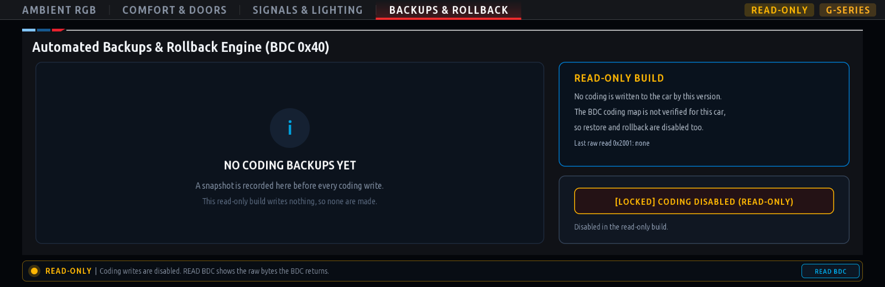

# BMW iDrive 7 (MGU) — Custom Apps Suite

<p align="center">
  <b>Custom applications for BMW iDrive 7 (MGU High / Intel Atom A3960), rendered at 60 fps on the head unit's GPU and installed through the MGU Store.</b>
</p>

<p align="center">
  
  
  
  
</p>

---

## Credits & Acknowledgements

This repository is built on the open-source BMW iDrive 7 platform:

* [**cauliflowermossgrape/idrive7-apps**](https://github.com/cauliflowermossgrape/idrive7-apps) — the app runtime, the native OpenGL ES renderer, SOME/IP vehicle signals and the TASU UDS diagnostic transport.
* [**mgu-store**](https://github.com/robertnisipeanu/mgu-store) — the in-car app store, package manager and internet uplink by Robert Nisipeanu.

> [!NOTE]
> For SDK extraction, toolchain documentation, SOME/IP signal catalogs and renderer internals, see [**cauliflowermossgrape/idrive7-apps**](https://github.com/cauliflowermossgrape/idrive7-apps).

---

## Included Applications

| App | Version | Needs internet | Touches vehicle ECUs |
| :--- | :---: | :---: | :--- |
| [QuickCode](#1-quickcode-quick_code) | 1.0.2 | No | Reads the BDC only (no writes) |
| [Spotify](#2-spotify-spotify) | 1.0.7 | Yes | No |
| [M-Cinema](#3-m-cinema-m_cinema) | 1.0.9 | Yes | No (reads vehicle speed) |
| [M-Copilot](#4-m-copilot-m_copilot) | 1.0.1 | Yes | No (reads driving signals) |

### 1. QuickCode (`quick_code`)
**BMW G-Series BDC (`0x40`) coding viewer. Currently read-only.**


| Ambient RGB preview | Backups (read-only build) |
| :---: | :---: |
|  |  |

> [!WARNING]
> **Coding writes are disabled.** The DIDs and byte layouts QuickCode would write (`0x2001` comfort block, `0x2002` ambient RGB) have not been verified against BMW coding data (CAFD) for any real BDC. Writing them could change unrelated settings on the car's central gateway. Every write path — apply, restore defaults and rollback — is blocked by one hard switch in `apps/quick_code/safety.js`, and no `0x2E` (WriteDataByIdentifier) request is ever sent. Until the coding map is verified, use E-Sys or BimmerCode for coding.

What it does today:
* **Bus check**: confirms the BDC (`0x40`) answers over the head unit's own diagnostic transport (TASU). Without an answer, the app shows a lockout screen; it never assumes the module is there.
* **READ BDC**: reads DIDs `0x2001` / `0x2002` and shows and logs the raw bytes the BDC returns. The bytes are not decoded into option states, because the map is unverified.
* **Planned options** (shown, locked): Auto Start/Stop memory, instant mirror fold, continuous window roll-up, one-touch tailgate, 5-flash comfort signals, curb mirror tilt, acoustic lock chirp, flashing brake force display and ambient RGB presets.
* **Safety layer, ready for when writes are enabled**, fail-closed by default:
  - requires live engine-speed and vehicle-speed data (demo data never counts), engine at 0 rpm and the car standing still;
  - requires BMW's own vehicle state to report Diagnostic Mode (`VehicleCondition` = `PRUEFEN_ANALYSE_DIAGNOSE`), not a guess from 0 rpm;
  - matches every UDS reply to its request (service and DID echo), one request at a time per ECU, then verifies writes by read-back;
  - snapshots the state before every write for rollback.

---

### 2. Spotify (`spotify`)
**Spotify Connect controller and library browser on the iDrive 7 central display.**


* **Cloud QR pairing over any network**: the Connect tab shows a QR code for [`pair.html`](https://hexlay.github.io/idrive7-custom-apps/pair.html). Sign in on your phone (cellular data or Wi-Fi) and the tokens reach the car **end-to-end encrypted** (AES-256-GCM, a key that only exists in this car's QR code). The car ignores anything on the pairing channel that is not encrypted with its key, including unpair requests.
* **Library & playback**: playlists, liked songs, now playing with the queue, and switching between Spotify Connect devices.
* **Internet through the MGU Store uplink**: looks up names through the uplink's DNS (see [Internet access](#internet-access)) and checks connectivity with a real HTTPS request. Without internet the player locks with **NO INTERNET CONNECTION**, **Retry** and **Switch to Demo Mode**.
* **Robust sessions**: tokens refresh once even when several requests expire together, the pairing survives restarts, and TLS certificates are always verified (a head-unit clock that is days off at boot is tolerated, as in the MGU Store's own updater).

| Phone QR Pairing | No Internet |
| :---: | :---: |
|  |  |

---

### 3. M-Cinema (`m_cinema`)
**21:9 cockpit video player with in-car YouTube search and casting from the YouTube app.**

| Player | In-Car Search | Link with TV Code |
| :---: | :---: | :---: |
|  |  |  |

* **Search in the car**: on-screen keyboard (touch or the iDrive controller), quick category chips and thumbnail results.
* **Cast from the YouTube app**: in the YouTube app, **Settings > Watch on TV > Link with TV code**, then enter the 12-digit code on the Connect tab. Videos tapped on the phone then play on the central display. The receiver recovers by itself after connection loss.
* **Motion lockout** (Settings > Motion safety lockout): *Auto* pauses the video while the car moves faster than 3 km/h; *Strict* also locks while the speed is unknown; *Always Allow* turns the lock off.
* **Reliable playback**: the video downloads to a RAM cache (up to 300 MB, limited by free space) and plays once it is complete, with a buffering progress screen; stalled downloads resume where they stopped. Streams are capped at 720p to keep the Intel Atom cool.

---

### 4. M-Copilot (`m_copilot`)
**AI co-driver and assistant for BMW G-Series vehicles.**


* **Ask about your car**: topic chips across Dynamics, Thermal, Chassis and Care (launch, drift and xDrive modes, turbo cooling, tire grip, oil specs and more), or type your own question with the on-screen keyboard. Answers take live driving signals (speed, temperatures) into account.
* **Your choice of AI provider**: Google Gemini, Anthropic Claude, OpenAI, Groq or OpenRouter.
* **Pair from your phone**: scan the QR code and enter the provider and API key on [`copilot.html`](https://hexlay.github.io/idrive7-custom-apps/copilot.html). The key reaches the car end-to-end encrypted, as with Spotify.
* **Read-only**: M-Copilot only reads driving signals and never writes to any ECU.

---

## How to Install via MGU Store

The recommended way to install and update these apps is the [**MGU Store**](https://github.com/robertnisipeanu/mgu-store):

1. On the central display, open **MGU Store > Sources > Add source**.
2. Enter this repository:
   ```text
   hexlay/idrive7-custom-apps
   ```
3. Tap **OK**. The MGU Store reads `mgu-repo.json` and lists the apps.
4. Tap an app to install it. Updates appear in the store when a new version is pushed.

### Internet access

Spotify, M-Cinema and M-Copilot need the MGU Store's **internet uplink** (`mgu-uplink`): Wi-Fi such as a phone hotspot, a USB-tethered phone, an LTE stick or a USB Ethernet adapter. The store routes only apps that declare `"mguInternet": true`, and the head unit's own resolver cannot reach the internet, so these apps resolve names through the DNS servers of the uplink's lease (`kit/runtime/uplink.js`).

If an app says it is offline while the store shows **Online**, look for the `uplink:` line at the start of the app's log (`<app>.log` in its data folder):
* `lease <ip> via <interface>` — the app is routed; the problem is elsewhere.
* `no lease ... uplink is online but this app is not routed` — reinstall the app from the store so it is added to the uplink's app list.
* `no lease ... uplink offline or not installed` — connect the store to a network first.

---

## Platform & Developer Documentation

For everything else, including:
* **SDK extraction & setup** (`kit/tools/extract_sdk.js`)
* **Vehicle SOME/IP signal catalogs**
* **The native C / Wayland / OpenGL ES GPU renderer** (`mgu-render`)
* **Controller input hooks** (`mgu-inputgate`)
* **OBD-ENET / SSH deployment scripts**
* **Creating new apps**

👉 **See the source repository: [cauliflowermossgrape/idrive7-apps](https://github.com/cauliflowermossgrape/idrive7-apps)** and the [**MGU Store guide**](https://github.com/robertnisipeanu/mgu-store).

To build locally: `python3 kit/tools/build.py <app_id>` writes `dist/<app_id>@<version>.tgz`. `node kit/tools/emu.js <app_id>` runs an app in the browser emulator, and `node kit/tools/preview.js dist/<app_id> <outDir>` renders it to PNGs (with `MGU_PREVIEW_BDC=1`, a stub BDC lets QuickCode's pages render).

---

## Privacy & Security

* **No hardcoded secrets**: this repository contains no API keys, client secrets, tokens or personal identifiers.
* **End-to-end encrypted pairing**: Spotify tokens and AI provider keys travel from the phone to the car through a public relay (`ntfy.sh`), encrypted with AES-256-GCM using a key that only exists in the car's QR code. The car accepts only messages that decrypt and authenticate with that key.
* **Verified TLS**: all requests that carry tokens or keys verify the server's certificate chain and hostname; only the head unit's possibly wrong clock is tolerated.
* **Local data**: tokens (`spotify_auth.json`), app state and QuickCode snapshots stay in each app's data folder on the head unit.
* **Git protection**: `*_auth.json`, `*_state.json`, `*_backups.json`, `*.key` and `*.pem` are excluded in `.gitignore`, and the build never packages them.

---

## License

This project is released under the GNU General Public License v3.0 or later.
Not affiliated with or endorsed by Bayerische Motoren Werke (BMW) AG.
