# iDrive 7 custom apps

Three apps for BMW iDrive 7 head units (MGU), installed through the [MGU Store](https://github.com/robertnisipeanu/mgu-store). They run on the app runtime and GPU renderer from [cauliflowermossgrape/idrive7-apps](https://github.com/cauliflowermossgrape/idrive7-apps).

| App | Version | Internet | Reads from the car |
| :--- | :---: | :---: | :--- |
| [Spotify](#spotify) | 2.0.1 | Yes | Nothing |
| [M-Copilot](#m-copilot) | 2.0.1 | Yes | Driving signals, service list, fault memory (read-only) |
| [Speed Limit](#speed-limit) | 1.0.13 | No | Position, speed and power state (read-only) |

## Install

1. In the car, open **MGU Store > Sources > Add source** and enter `hexlay/idrive7-custom-apps`.
2. For Spotify and M-Copilot, add `cauliflowermossgrape/idrive7-apps` as a source too, and install the renderer (`idrive7-renderd`) and the controller gate (`mgu-inputgate`) from it. Most cars that run these apps already have them. Speed Limit needs neither.
3. Install the apps. New versions show up in the store.

Spotify and M-Copilot need the store's internet uplink: a phone hotspot, a USB-tethered phone, an LTE stick or a USB Ethernet adapter.

On older firmware (such as MainApp 6.5.5) the store leaves out any vehicle signal the head unit doesn't know, so the apps still install. The app's log lists what was left out.

## Spotify

Control Spotify Connect and browse your playlists and liked songs on the central display in the **Afterglow** cockpit interface (60 fps full-screen GPU).

- **Playlists & Liked Songs:** Cover-art playlist cards, editorial headers with one-tap **Play** and **Shuffle**, two-line track rows with album art, a two-column **Liked Songs** grid, and an ambient-tinted mini player dock.
- **Now Playing:** Blurred cover-art backdrop, seek bar, shuffle, repeat, like, and a 3D depth **Up Next** cover queue. Playback control needs Spotify Premium.
- **Connect:** Pair by scanning the QR code on the Connect tab and signing in to Spotify on your phone, and switch between Spotify Connect devices. Disconnect from the phone too.
- **Demo mode:** Plays built-in sample tracks with generated artwork without an account.
- **Settings:** Inline segmented controls for playback mode (Online / Demo) and playback sync rate (1–10 s).

| Now Playing | Liked Songs |
| :---: | :---: |
|  | 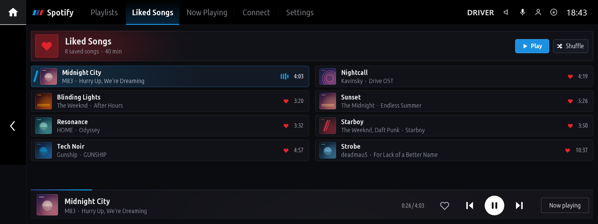 |
| **Connect & pairing** | **Settings** |
| 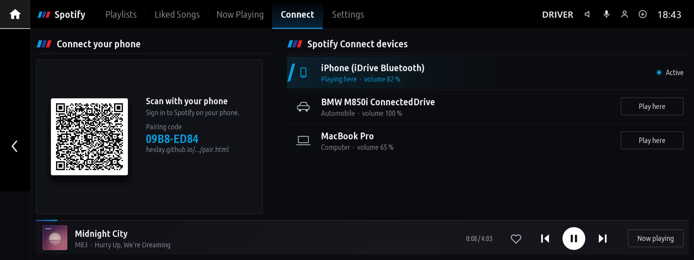 |  |

## M-Copilot

An AI co-driver in the **Afterglow** cockpit interface that answers with your car's own data: live readings, warning messages, the service list, the fault memory with BMW's fault descriptions, and a read of the engine computer (boost, intake air, load, timing, fuel pressure, gearbox oil, misfires).

- **Answer & 3D telemetry:** Clean answer view paired with a live 3D extruded history ribbon for **Oil**, **Coolant**, **Boost**, and **12 V battery** with peak/delta tracking and operating limits.
- **Topics & custom questions:** 24 categorized topics across Check, Drive, Perform, and Know-how (with `ECU SCAN` indicators for fault-reading prompts), plus an on-screen keyboard with quick presets.
- **Driving safety:** While the car is moving, answers are shorter in larger text and typing is locked; topics and follow-up chips still work, and a half-typed question is kept for when you stop.
- **Data check:** Two-zone telemetry coverage console showing live readiness across Car & links, Live signals, and Engine computer, with manual **Read engine** and **Read fault memory** triggers.
- **Connect:** Scan the QR code from your phone to choose Gemini, Claude, OpenAI, Groq, or OpenRouter, enter your API key, and set your car profile (model, tune, mods) and answer language.
- **Strictly read-only:** Enforced at the diagnostic transport layer — fault memory and engine values are read-only (no fault clearing or ECU writes are possible) and never read while the engine is starting or stopping. Nothing runs while the app is off screen.

| Topics | Your own question |
| :---: | :---: |
| 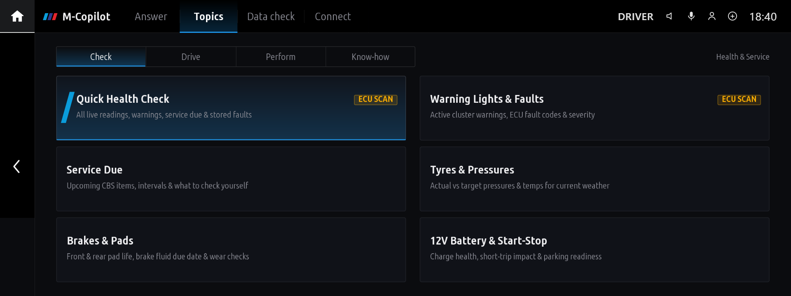 |  |
| **Data check** | **Connected** |
|  | 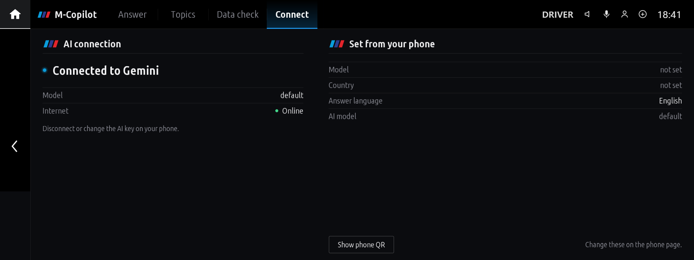 |
| **Phone page QR** | |
|  | |

The screenshots are from the browser emulator with its sample B58.

## Speed Limit

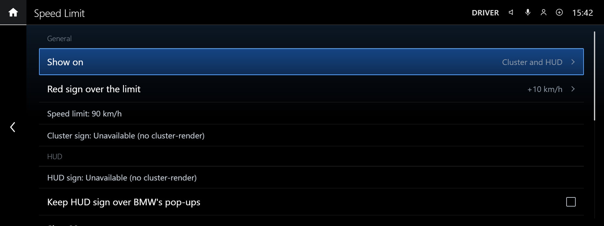

> [!NOTE]
> **Georgia only.** The app ships with an offline OpenStreetMap map of Georgia and Georgia's default limits.
> Tested in the car (G15, HU_MGU_01 030_016_002) and it works.

> [!CAUTION]
> ### The limits come from OpenStreetMap and some are wrong or out of date. Always follow the signs on the road.

The speed limit of the road you're on, on the head-up display and on the cluster's phone map, worked out offline.
No internet, no BMW map, and nothing is sent to the car: it only reads the car's position, speed and power state.

- **Page** laid out like Maps on cluster's: Show on (Cluster, HUD, both, Off), red sign over the limit (+5 to +20
  km/h), what to show when there's no limit (nothing or ---), speed cameras, and size and position for each sign.
- **Speed cameras:** a camera ahead on your road within 400 m adds a pill with the distance to the sign.
- **Roads without a limit** show Georgia's legal default with a grey ring: 60 in a settlement, 90 outside, 110 on
  motorways (not their ramps), 20 in living streets.
- **Correct a wrong limit in the car:** on the road, pick its real limit under **This road > Correct its limit**. It
  covers that OpenStreetMap road (both directions, unless the map gives them different limits) and nothing past it,
  is kept by app updates and new maps, and goes by itself once OpenStreetMap has the same limit. **Undo** and
  **Clear all** are there too.
- **Report a problem without SSH:** the drive log (on by default) notes each road and limit change with its place.
  **Show the log as QR codes** puts it on screen, with your corrections: photograph the codes and attach them to a
  [Speed Limit issue](https://github.com/hexlay/idrive7-custom-apps/issues/new?template=speed_limit.yml).
- **A fresh map every month:** OpenStreetMap is read again on the 2nd of each month; when a road, limit or camera
  changed, a new version comes to the MGU Store. Corrections sent in are fixed in OpenStreetMap by a person (never
  from the car), reach every car with the next map, and the car's own correction then goes by itself.
- **Starts with the car and draws no power parked:** stopped, locked or Off, it drops its subscriptions, closes the
  map and gives the displays back. About 1 MB of memory; wakes twice a second while driving, never while parked.
- Needs **cluster-render** (comes with Maps on cluster from `robertnisipeanu/idrive-apps`) for the HUD and cluster.

| Show on | Red sign over the limit |
| :---: | :---: |
| 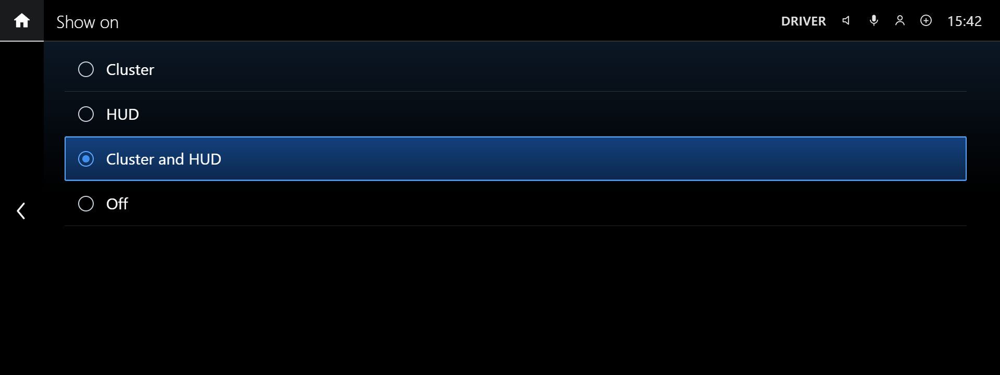 |  |
| **HUD settings** | **Show on: Cluster** (the HUD settings greyed) |
| 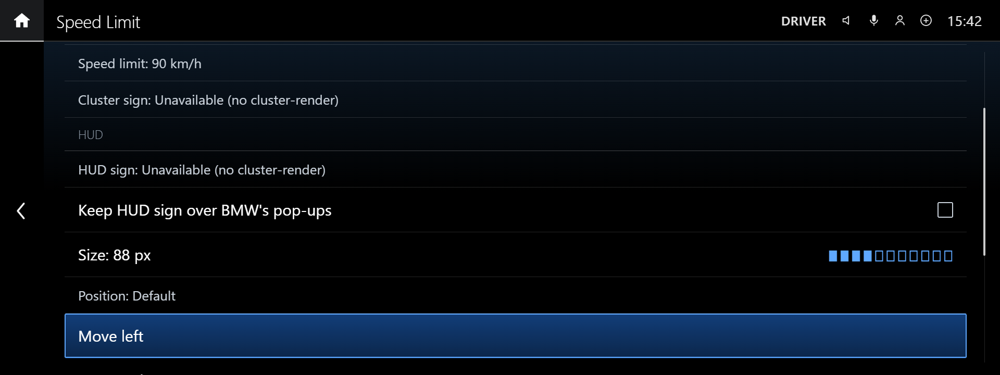 | 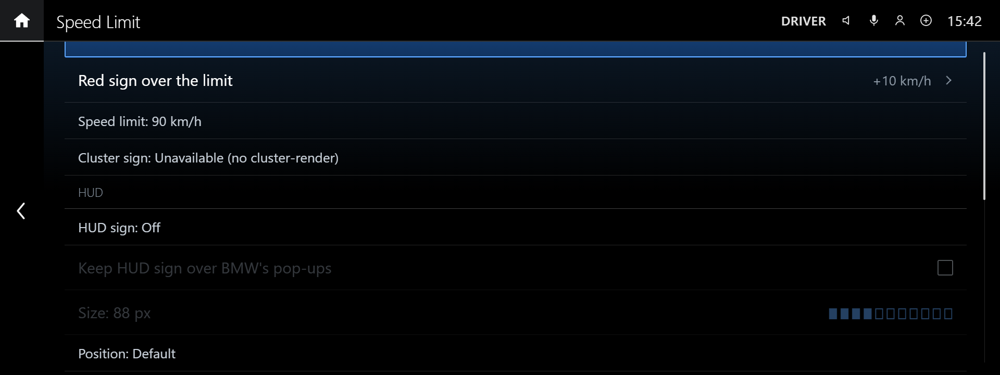 |
| **Cluster settings** | |
|  | |
| **Speed cameras** | |
| 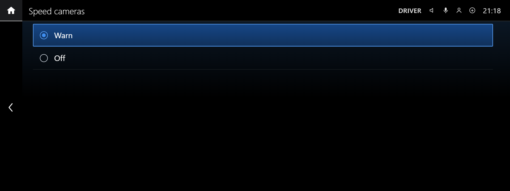 | |
| **When there's no limit** | **The signs** |
| 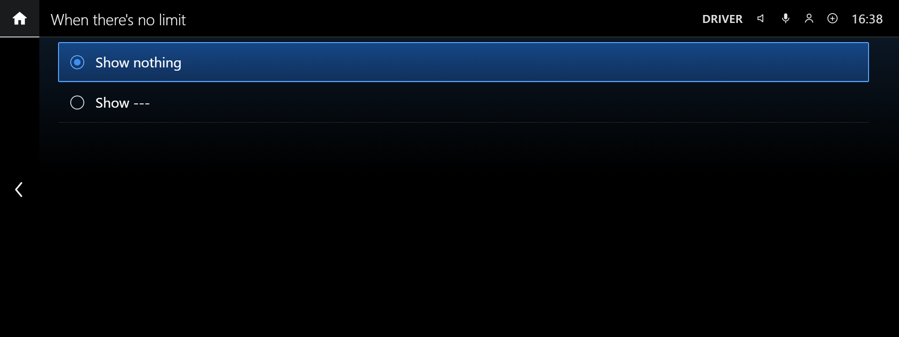 |  |
| **This road** (corrected to 50 km/h) | **The log as QR codes** |
| 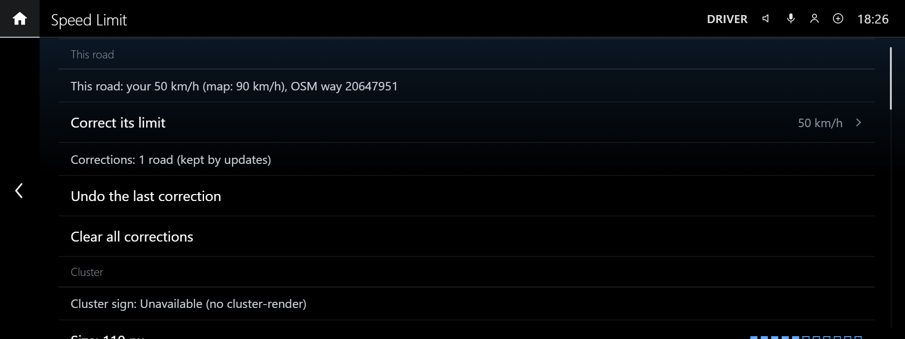 | 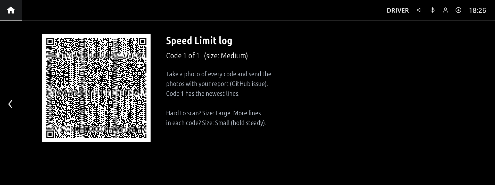 |
| **Head-up display** (black is see-through) | **Cluster, over the phone map** |
| 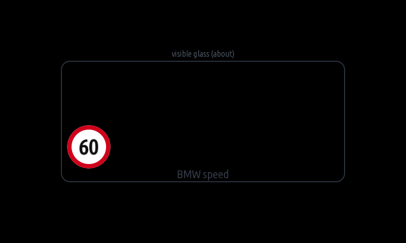 |  |

Screenshots are from the emulator; the HUD and cluster pictures are the layers the app sends, not photos. Map data © OpenStreetMap
contributors, [ODbL](https://opendatacommons.org/licenses/odbl/1-0/) (`apps/speed_limit/georgia.pack`, from
Geofabrik's Georgia extract).

## Phone pages

The pairing pages ([My cars](https://hexlay.github.io/idrive7-custom-apps/)) can be added to the home screen as an app called **iDrive Apps**: on iPhone use Safari's **Share > Add to Home Screen**, on Android Chrome's **Install app**.

New phone or cleared browser? Scan **Show QR for the phone page** on the app's Connect tab to get the car back.

## Privacy

- Keys and Spotify logins go from the phone to the car through the public relay `ntfy.sh`, end-to-end encrypted (AES-256-GCM) with a key that exists only in the car's QR code. Old or repeated messages are rejected. See [`kit/runtime/link_crypto.js`](kit/runtime/link_crypto.js).
- On the car they are stored in the app's data folder, readable only by that app. This repository contains no keys or secrets.
- Every request that carries a key checks the server's certificate.

## When an app says it's offline

If the store shows **Online** but an app doesn't, look at the `uplink:` line near the top of the app's log (`<app>.log` in its data folder):

- `lease <ip> via <interface>`: the app is routed, the problem is somewhere else.
- `no lease ... not routed`: reinstall the app from the store.
- `no lease ... uplink offline or not installed`: connect the store to a network first.

## Development

- `python3 kit/tools/build.py <app_id>` builds `dist/<app_id>@<version>.mgu`. It needs `oap-sdk`, extracted from your own head unit with `kit/tools/extract_sdk.js`.
- `node kit/tools/emu.js <app_id>` runs an app in the browser emulator. Add `--car b58` or `--car n63` for a sample car.
- The tests are in `kit/tools/test_*.js` and run in CI on Node 8.9.4 and 8.16.2, the versions on the head units.
- Speed Limit's map: `python3 kit/tools/pack_sli.py georgia-latest.osm.pbf -o apps/speed_limit/georgia.pack` (a
  Geofabrik extract, `https://download.geofabrik.de/europe/georgia/georgia-latest.osm.pbf`; about a minute).
  `node kit/tools/test_speed_limit.js` replays drives through Tbilisi on it; after a build,
  `node kit/tools/test_speed_limit_power.js` checks its wake-ups from start-up to parked. Wrong limits are fixed in
  OpenStreetMap and come in with the next map, never by editing the pack.
- The monthly map: `.github/workflows/speed_limit_map.yml` (also **Actions > Speed Limit map > Run workflow**)
  builds it again, compares it (`kit/tools/sli_diff.py old.pack new.pack`), tests it and pushes a new version
  (`kit/tools/bump_version.py speed_limit`) only when a road, limit or camera changed.
- Speed Limit's QR log: `pip install zxing-cpp pillow`, then `python3 kit/tools/qrlog_decode.py photos/` prints the
  log from the photos (the format of idrive7-apps' QR log). With `--osm` it prints the drivers' corrections as roads
  to check and fix in OpenStreetMap, with links to each road and the editor and the tag to set; it also takes a
  decoded log or the car's `corrections.json`.

For the platform itself (signals, renderer, controller input, deploying over SSH) see [idrive7-apps](https://github.com/cauliflowermossgrape/idrive7-apps).

## Credits and license

Built on [cauliflowermossgrape/idrive7-apps](https://github.com/cauliflowermossgrape/idrive7-apps) (MIT): the runtime, renderer, vehicle signals and diagnostics transport. M-Copilot also uses its fault-text database (`dtc_db.pack`) and the engine and battery identifier tables from its M Vitals and eDrive apps. The [MGU Store](https://github.com/robertnisipeanu/mgu-store) is by Robert Nisipeanu.

Released under GPL-3.0-or-later ([`LICENSE`](LICENSE)). The MIT notice of idrive7-apps is kept in [`LICENSE.MIT`](LICENSE.MIT) and ships with every app package. `kit/renderd` keeps its own licence files.

Not affiliated with or endorsed by BMW AG.
